# DEVLOG — «Атака на запоминание»

Журнал разработки. Обновляется с каждой версией и пушится вместе с ней. Если работу подхватывает другой агент — начинать отсюда, затем `REBUILD-v2.md` и `game-v2/README.md`.

## 11.10.2026 — Unity M0, нативный каркас готов к тесту

- Прочитан полный `CODEX-BRIEF.md`, исходная точка переноса — `9d9521b`. Работа отделена в ветку `codex/unity-m0`, каталог `unity-game/`.
- Установлен официальный Unity 6.3 LTS **6000.3.26f1**, URP **17.3.0**. Конкретный выпуск подтверждён установщиком, а URP — манифестом встроенного пакета.
- Написаны: управление через Input System (мышь/клавиатура/геймпад), капсула с приседом, выбор ближайшего интерактива с приоритетом в пределах 15 см и блокировкой стенами, двери с остановкой перед игроком, предметы, выключатели, меню/пауза, JSON-сохранение с резервной копией, базовые настройки, лёгкий VHS через Full Screen Pass.
- Подготовлен Editor-генератор метрической тестовой квартиры и Windows-сборки. Объёмы мебели и двора — технические заменители; художественная M1 не выполнена. Это явно написано в стартовом меню.
- **12/12 EditMode и 5/5 PlayMode прошли.** Проверены предметы и препятствия, дверные проёмы, пауза, низкий потолок, новая игра и совместное восстановление состояния из файла. Последняя сборка дополнительно проверена самим Windows-плеером, exit code 0, ошибок 0.
- Unity Personal активирована через обычный Hub. Повреждённая длинным путём установка заменена редактором в коротком каталоге. Input System обновлён до 1.20.0 по манифесту Unity; исправлена ошибка HLSL и ослаблен VHS после осмотра настоящих кадров.
- Реальные кадры и результаты — `unity-game/QA/`, условия проверок — `unity-game/TESTING.md`. Короткий замер: 58.65 FPS в среднем, максимальный кадр 62.65 мс на GTX 1650 SUPER; запись PNG может влиять на результат. Полного профилирования нет.
- **Живое прохождение пользователем ещё предстоит.** Захват окна через Computer Use дважды завершился тайм-аутом, поэтому ручной UI-тест не заявлен. Каркас не является художественным прологом: M1, сюжет и поздние системы ещё не выполнены.
- Продолжение и ограничения: `UNITY-MIGRATION.md`, `unity-game/README.md`.

## Как устроено (кратко)

- `game-v2/` — игра: Three.js 0.180 + Vite. `npm install --include=dev`, `npm run dev` (http://127.0.0.1:5173), `npm run build:single` → `dist-single/index.html` (один файл).
- `desktop-v2/` — оболочка Electron (Windows .exe, приоритет дискретной видеокарты). Zip кладётся в GitHub Releases (>100 МБ).
- `src/core` — рендер (постэффект плёнки: VHS, перемотка, рыбий глаз, кровь/разрыв), ввод, звук (всё синтезируется + голоса Piper), UI.
- `src/world` — квартира, предметы, двор, свет, `phases.js` (P.T.-деградация квартиры по петлям).
- `src/game/game.js` — сценарий и петли; `creature.js` — монстр; `scares.js` — повешенная бабушка, «я в кресле» для ТВ, камера трансляции; `hands.js` — предметы в руках и когти монстра у камеры; `script.js` — все тексты.
- Проверки: `tools/qa-v3.mjs` (прохождение v3), `tools/qa-flow.mjs` (тёплая часть), `tools/shot.mjs` (скриншоты с параметрами `?shot=x,z,yaw,pitch&creature=...&gore=...`). Запускать против `vite preview --port 5174`. Headless Chrome: `LD_LIBRARY_PATH=$HOME/locallibs/root/usr/lib/x86_64-linux-gnu`.
- Голоса: `tools/make-voices.mjs`, Piper в `~/tts`. Лицензия голоса irina «неизвестна» — перед релизом заменить на актёров.

## v1 / 0.6 — предыдущий агент
Отвергнута пользователем целиком («вообще не понравилось»).

## v2 — 10.10.2026, пересборка с нуля
Новая квартира-хрущёвка, двор, сюжет 1996 года, четыре смерти, откат к 21:59:40, озвучка. Отзыв: «намного лучше чем 1 версия», но баги.

## v2.1 — 10.10.2026
Исправлено: спички не брались (зона «Холодильник» перекрывала), кресло, ТВ сквозь стену, пустота на лестнице, рывки камеры (баг pointer lock), рост героя. Оптимизация теней, авто-качество, FPS на F3. Electron-приложение (Release v2.1).

Отзыв пользователя: визуальные баги (пальто, щели у двери, зеркало в темноте), зависания при работе со светом, «скучно», «детский квест», первая смерть должна быть обязательной, механика закрытых глаз слишком лёгкая, монстр не страшный («бородач», «посмешище»), хочет срывание лица от первого лица даже при победе, P.T.-петлю квартиры (тёплая → холодная → гниль → кошмар, дверь ведёт обратно в квартиру), скример с повешенной бабушкой, журнал разработки.

## v3 — 10.10.2026 (Release v3)
- Зависания при свете: источники больше не переключают `visible` (это пересобирало все шейдеры), только яркость; тени перерисовываются точечно.
- Визуал: новые пальто (складки, рукава, воротник, пуговицы), тапки, сапоги на полу; дверные упоры у входной двери — свет больше не бьёт в щели; зеркало темнеет без света.
- Монстр переписан: тощий, ~2.4 м, сгорбленный, рёбра и позвоночник, маленький череп на длинной шее, бабушкино лицо-маска со швами и разными глазницами, отваливающаяся челюсть с иглами-зубами, лохмотья платка и сорочки, руки ниже колен с длинными пальцами, рваная походка, поворот шеи рывками.
- Смерть: рывок с открытой пастью → когти у камеры → разрыв лица (шейдер `uTear`) → кровь по экрану (`uGore`, потёки) → красное затемнение; звуки разрыва, хруст, крик.
- Петли: первая петля непроходима (шпингалет балкона сломан). После смерти герой вспоминает дедов ремень в шифоньере — со 2-й петли им привязывается ручка к батарее.
- Вместо «закрыть глаза»: прятки (шифоньер / под кроватью / под кухонным столом) и задержка дыхания (Пробел, запас ~9 с). Монстр выходит из заклинившей ванной, сначала проверяет все места, где ты прятался раньше, затем стоит у твоего укрытия и слушает.
- P.T.-фазы: 1 — холод (синий свет, иней), 2 — гниль (плесень, отходящие обои, мухи, лишняя дверь, остановившийся маятник), 3 — кошмар (красный свет, кровь, «ПОМНИ» на стенах, лампадка погасла, входная дверь ведёт обратно в квартиру).
- Скримеры: ТВ сам включается и показывает тебя в кресле, а за спиной — её; в фазе гнили — галлюцинация повешенной бабушки в спальне (табуретка и тапок остаются).
- Финал: даже при победе «бабушка» открывает дверь своим ключом, подходит — «А ты меня помнишь?» — лицо сползает, и она срывает твоё. Карточка «Это был не последний раз».

Проверено (headless): петля 0 заканчивается смертью; петля 1 — ремень, балкон, ТВ-скример, звонок по коду, прятки под кроватью: монстр сначала проверяет прошлое укрытие (шифоньер), потом стоит у кровати — с задержкой дыхания выжить можно; финал с «бабушкой» и срыванием лица доходит до титров. Ошибок в консоли нет. Живого прохождения человеком не было.

Баланс прятки: запас дыхания 13 с, монстр стоит у укрытия 6 с, задерживать нужно с момента, когда он остановился (2 с форы).

## Отзыв на v3 (10.10.2026)
- Браузерная версия — «колхоз», дорабатывать её смысла нет. Нужен нормальный движок (Unity, как Fears to Fathom), красивые модели, настоящие анимации.
- Откат/запоминание должен быть ОДИН раз: первая атака → смерть → откат → вторая попытка с тем, что запомнил. Возрождение после каждой смерти — «глупо».
- Смерть: должно быть видно, как когти хватают и срывают кожу с лица (анимация, а не эффект экрана).
- P.T.: случайная дверь (уже в первой атаке или во второй), за которой другая версия квартиры.
- Следующий шаг: перенос на движок; выбор движка и источника ассетов — за пользователем.

## Следующие шаги / открытые вопросы
- Оценка пользователем страха и монстра на живом прохождении.
- Возможно: ползание по потолку, отражение монстра в зеркале, более долгий кошмар-этап.

## 2026-10-11 — Unity M1 preview: квартира и сравнение реальных кадров

Продолжено наполнение нативной Unity-сцены: авторская Blender-мебель, PBR/CC0, тёплый интерьер, отдельная отделка ванной, двор, балкон, лестница, печатные детали и бытовой звук. Два состояния запечённого освещения, Forward+ и мягкие тени, исправлены проходы возле кресла и зеркала, ранний сбор ошибок, UV-конфликт двора и русская кодировка.

33 теста прошли, настоящий Windows-плеер без ошибок; 11 кадров и сравнение с официальными Fears to Fathom — unity-game/QA. Замер и ограничения в TESTING.md. Это промежуточный M1 preview: полный список реквизита ещё не закончен, качество референса не подтверждено, история и монстр не реализованы. Дальнейшая работа конкретизирована в M1-NEXT.md. Общая цель разработки не считается завершённой.

Подпись коммитов отключена локально для репозитория по просьбе пользователя; глобальная рабочая настройка не менялась.

## 11 октября — Unity M1 preview 0.2.1

Расширены все комнаты и двор; добавлены два отражения комнаты. Все изменения геометрии воспроизводятся из Blender/Python и Unity-генераторов. Исправлены пересечения ткани, UV тюля, ориентация зеркал и три узких прохода. 23 EditMode + 12 PlayMode прошли; настоящий Windows-player записал 13 PNG, завершился с кодом 0 и без ошибок игры. 1280×720/renderScale 1, GTX 1650 SUPER: 59.998 FPS при лимите 60, P95 16.669 мс; у зеркала P95 16.672 мс, при переключениях света 16.673 мс. Есть служебная shutdown-телеметрия остаточной памяти; отсутствие утечек не заявляется.

Просмотрены все 13 игровых кадров и четыре официальных референса сравнения. Материалы/реквизит и внешний свет всё ещё уступают FtF. M1 остаётся preview, сюжет не перенесён. Дальнейшие конкретные дефекты — unity-game/M1-NEXT.md; проверки — TESTING.md; попарное сравнение и кадры до/после — QA/compare.html. Архивы и исходники выпускаются как unity-m1-0.2.1 в ветке codex/unity-m1; предыдущий релиз сохраняется.

## Unity M1 preview 0.2.2 — проверенный checkpoint

Новый ящик трюмо, объёмные чаши, накидка и исправленный свет/материалы. 24 EditMode + 17 PlayMode; затем material-only polish, повторное запекание и native capture pass15. 15 кадров 1080p, ошибок 0, средний FPS 59.997 при лимите 60. Подробные ограничения и оставшаяся художественная работа — unity-game/TESTING.md и M1-NEXT.md. M1 не завершена, качество FtF не объявлено достигнутым.

## Unity M1 0.2.3 — кресло и снег

Реализована посадка с камерой/коленями/пледом, сохранением и безопасным выходом. Исправлен отсутствовавший модуль частиц. 45 тестов, 17 кадров 1080p, native exit0/errors0. См. unity-game/M1-SEATING.md и TESTING.md. M1 и художественная приёмка не завершены.

## Unity M1 0.2.4 — личные вещи и материалы

Разделены материалы дерева, две рамки заполнены вымышленными семейными фото, поправлен провод контроллера. Исправлена повреждённая кодировка полного генератора. Полная генерация/запекание, 45 тестов, 17 кадров 1080p, native exit0/errors0. См. unity-game/M1-PERSONAL-MATERIALS.md и TESTING.md. M1 и художественная приёмка не завершены.

## Unity M1 0.2.5 — ткань и кухонное окно

Постельные подушки, складки занавесок и прозрачность тюля переработаны. Добавлен 18-kitchen-window. Полная генерация/две запечки, 45 тестов, native exit0/errors0. Подробности — unity-game/M1-TEXTILES.md; настоящие кадры и разбор — QA/compare.html. M1 не завершена и не принята пользователем.

## 2026-10-11 — M1 0.2.6

Крепления кухонной занавески и подшивка верхнего края; побелка вместо коричневой глиняной фактуры потолка. Пересчитаны свет/probes/отражения, Windows pass21: 18 кадров, native exit0/errors0. Новые изменения декоративные, 45 тестов остаются pass18. Пик переключения света 48.076мс не устранён. Документ: unity-game/M1-CEILING-AND-CURTAIN.md (из unity-game — M1-CEILING-AND-CURTAIN.md). M1 остаётся незавершённой.

## 2026-10-11 — M1 0.2.7

Отдельные плафоны люстры, мягкая эмиссия и привязка к выключателю. Pass22 визуально выявил чёрные тени стекла — не опубликован. Pass23 устранил их и повторил свет/сборку. 46 тестов pass22, native pass23 exit0/errors0,18 кадров. Документ M1-OPAL-LIGHTING.md в unity-game. M1 не принята.

## 2026-10-11 — M1 0.2.8

Новые лепестки/листья/соцветия, поправлены положения горшков. Исходник моделей сжат без потерь; Unity-полная генерация подтвердила импорт. Pass24:46 тестов, обе запечки, Build/native exit0/errors0,18 кадров. Исправлена устаревшая версия шаблона сравнения. Подробности unity-game/M1-PLANTS.md. M1 не принята.

## 2026-10-11 — M1 0.2.9

Шесть наружных ламп получили локальное объёмное рассеяние. Ярко-красный pass25 отвергнут; pass26 исправляет двойную гамму и силу.48 тестов,Build/native exit0/errors0,18 кадров. Двор uncapped4.360/3.844мс on/off; не универсальный бюджет. Источники и ограничения — unity-game/M1-EXTERIOR-FOG.md. M1 не принята.

# Фасады — M1 0.2.10

## Что изменено

Вместо повторяющихся одиночных окон и плоских балконных панелей — три дома с рамами, фрамугами, тёмными откосами, выступающими подоконниками, вертикальными стыками панелей, цоколем, карнизом и водостоками. Балконы имеют боковины и плиту; часть застеклена деревянными/светлыми рамами, часть открыта. Их вертикальное положение следует архитектуре, а поздние изменения различаются между квартирами. Цвета приглушённые: серый, выцветший зелёный, охра.

214 окон используют восемь авторских текстур128×128: тёмные, тусклые, тёплые и холодные варианты, разные положения занавесок, жалюзи и нижние силуэты мебели. Это рисунок на поверхности, не настоящая геометрия комнат. Распределение воспроизводимо через фиксированный seed; прежняя яркая диагональная последовательность устранена. Пятый этаж, масштаб домов, двор и положение входов сохранены.

ApartmentFacades.cs группирует кубоиды по материалу и дому. Получилось54 renderer/32964 треугольника для трёх фасадов (70+54+90 окон), без сотен отдельных GameObject/Collider и без новой площади lightmap. UV стен заданы в метрах. Дальняя архитектура не использует комнатные Light Probes, чтобы не переносить тёплый квартирный свет наружу. Сохранён общий туман и рассеяние наружных ламп0.2.9.

## Проверка

Pass27: полная Generate. Pass28: светлее материалы штукатурки/рам/панелей → две запечки →24 EditMode +24 PlayMode → Windows Build → native smoke. 18 кадров1920×1080, exit0/errors0. Основной короткий прогон cap60: mean 59.997FPS, p95 16.669мс, max 16.751мс. Переключения света max 16.679мс, зеркало max 16.710мс. Это не полное прохождение и не гарантия для других ПК. Визуальные замечания — QA/M1/visual-review.json; сравнение одного ракурса до/после — QA/compare.html.

## Источники и пределы

- Архитектурный референс: [Khrushchevkaβφ.jpg, GreatBernard,2023,CC0](https://commons.wikimedia.org/wiki/File:Khrushchevka%CE%B2%CF%86.jpg). Рассмотрен настоящий снимок: неодинаковое остекление, рамы, боковые стенки и выцветшие балконные панели. Фото не добавлялось в текстуры игры. Это наблюдение конкретного дома, не заявление о точной серии нашей вымышленной постройки.
- [Norwood Hitchhike, официальный Steam](https://store.steampowered.com/app/1763050/): ранее сохранённые официальные кадры в сравнении. Они остаются ориентиром света, фактур и читаемости, а не источником скопированных игровых ассетов.
- Фасад использует уже учтённый CC0 plastered_wall_02; новые текстуры окон и геометрия авторские.

Мелкое старение фасадов пока условное; остекление балконов непрозрачное и без реальной глубины соседних комнат. Нет новой сюжетной интерактивности. M1 не принята пользователем. Земля и домашний реквизит требуют доводки; паритет с FtF не подтверждён. Low/Medium/High и ручная оценка атмосферы ещё впереди.

## Уточнение визуального направления, 2026-10-11

Заказчик просит не усиливать фотореализм и не собирать все предметы из брусков: брать хорошие готовые бесплатные модели, подбирать их по эпохе и силуэту. Бюджет около $10 допустим для показанного заранее удачного ассета; сейчас покупки не нужны. Рабочие критерии, источники, неподтверждённые зацепки происхождения FtF и аудит предметов: [unity-game/M1-ASSET-DIRECTION.md](unity-game/M1-ASSET-DIRECTION.md). Новая рабочая итерация заменяет TV на CC0 Television 01 (Gabriel Radić / Poly Haven); итог проверяется реальным Windows-плеером перед публикацией.

## 2026-10-11 — отмена прежнего плана, VIBE-RESEARCH имеет приоритет

VIBE-RESEARCH.md прочитан полностью (347 строк), сохранён в корне. Работа над остальными комнатами и публикация 0.2.11 остановлены. Изменения pass30 сохранены локально: 28 EditMode и 25 PlayMode прошли, native smoke завершился, но это НЕ приёмка кухни по новому ТЗ. Новый Windows-срез ещё не собран и не пройден. Готовые покупные ассеты ещё не получены. Unity 6000.3.26f1 / URP17.3 остаётся без миграции. Следующий документ: ASSET-SHOPPING.md; следующая сцена — только кухня и участок прихожей. Бытовые модели больше не генерировать. Приоритет: погружение, масштабы, свет, записанный бытовой звук; затем чайник и один скример.

### Подготовка закупки и кухонного среза

Созданы ASSET-SHOPPING.md (один рекомендованный набор; пять интерьерных кандидатов проверены по официальным карточкам/изображениям), ImportInbox/README.md и unity-game/KITCHEN-SLICE.md. Проверены галерея кухни34/54 и прихожей12/54 основного набора и файловый состав с вложенным URP-пакетом. Уточнения относительно VIBE: модульный кит требует6000.6.2; Old Furniture исходно5.4.3; полигонаж у нескольких наборов теперь указан. Старые модели не дорабатывались. Скачаны CC0 Overcast Soil Pure Sky2K и Plaster0042K в AssetStaging; MD5/ZIP CRC прошли. Платный арт пока не получен, новые материалы не внедрены. APV API проверен по установленному исходнику и документации6.3; в сцене не испытан. Новый билд/новые игровые скриншоты/прохождение отсутствуют — это подготовка, не показ игры.

VIBE SHA256: `c235b47fa2994a34a202dd9c9628409d2217602968084e0d9ffb82f3b816a8a8`.

## 2026-10-11 — подготовлена проверка масштаба импорта

ImportInbox проверена: только README, купленных ассетов нет. Добавлены RealSize (метаданные размеров/источник), editor-only RealSizeAudit и7 EditMode тестов. Измеряются фактические вершины в метрах с учётом иерархии, общий поворот не раздувает размер; чтение GPU-only импортного mesh без изменения Read/Write. В Ataka.Editor добавлена ссылка на уже установленный Unity.Collections. Unity6000.3.26f1:7/7 passed,exit0; отчёт TestResults/KitchenScale.xml. Запуск только тестов, без Generate/Bake/Build. Новые игровые модели/сцены не создавались. Не проверены готовые купленные модели, художественное качество, коллизии и прохождение кухни. Инструкция: unity-game/KITCHEN-SCALE-CHECK.md.

## 2026-10-11 — новое указание: рендер первым, бюджет0–20$

Новый VIBE прочитан целиком,54946байт,SHA256 542de1c91e0421a5293c20f945820e60b4f98e8c74e2dd6a10acd76f505441a8. Платный набор$59 отменён; ожидание покупки больше не блокирует работу. Приоритет540строк/point +дизеринг/квантование; затем бесплатный арт. Старые списки архивированы, ImportInbox/планы обновлены. Аудиоподготовка остановлена на чтении пяти открытых CC0-карточек; звуковые файлы ещё не скачаны. SoundFile установлен только в.tooling для будущей обработки. Следующий шаг — реальный URP-рендер и проверка кадра в Windows.

## 2026-10-11 — LightLab 0.1.0, только свет и VHS

- Windows native player: menu → все 6 ракурсов × 3 режима → Tension → Scare → Normal → menu → exit 0. Именно 18 PNG1920×1080; дополнительные меню/усиленные профили не включены в look-check. Ошибок в player log: 0.
- Все Light/GameObject активны после последовательности: True.
- 3/3 EditMode проверки пройдены: renderScale/bilinear/MSAA, четыре профиля/шейдер, шесть ракурсов/текстуры/вертикальная ориентация/масштаб предметов. Первое падение теста было в восстановлении отсутствующей стартовой сцены тестового раннера; исправлено, повтор прошёл.
- Переходы света на NVIDIA GeForce GTX 1650 SUPER: p50 16.67, p95 16.69, p99 16.81, максимум 17.02 мс. PNG-запись исключена из этих интервалов. Это короткий замер трёх переходов, а не длительный стресс-тест и не гарантия любого ПК.
- Использован исходный tools/look-check.js из GitHub; SHA256 `a457117f581f570a4780bc103bc3f8b560873e1864d80b270c063769d40e2081`. Пороги не изменялись. Скачаны все 37 официальных референсов из refs.txt.
- **ИТОГ ночь (13): в диапазоне FtF** — p50≈13, p99≈35, H/V яркости≈0.93, цвета≈0.96, зерно≈0.60.
- **ИТОГ тёплые (5): в диапазоне FtF** — p50≈55, p99≈252, H/V яркости≈0.82, цвета≈0.82, зерно≈0.62.
- 15/18 отдельных кадров проходят. Три исключения сохранены, не скрыты: view3-light1 (p99≈93 ниже120), view3-light3 (≈24 ниже25), view4-light3 (неокруглённый p99 чуть ниже25). Причина — в ракурсе нет яркого источника. Итоговые метрики считаются по всем 18 кадрам.
- Ручной проход **не подтверждён**: навык computer-use запустил именно выдаваемый LightLab.exe и обнаружил его окно, но Windows.Graphics.Capture дважды вернул timeout; дальнейшая автоматизация ввода остановлена. Нельзя записывать это как успешный ручной тест. Пользовательская проверка управления и ощущений остаётся открытой.

[Полный отчёт](unity-game/LIGHTLAB-REPORT.md). Равенство качества FtF не заявляется. Продолжение только после приёмки.

## 2026-10-11 — LightLab 0.1.1, осторожное улучшение с откатом

Заказчик одобрил прогресс0.1.0: попросил холоднее окно, меньше тёплой заливки и немного износа изображения. Сделан отдельный вариантB с переключениемF; исходный EXE/ZIP0.1.0 и архив исходников сохранены.

Два автопрогона36 кадров, ошибок0; 3/3 EditMode. Обе итоговые группы look-check проходят; уB 17/18 индивидуально, исключение view3-light1 сохранено. Ручное управление не подтверждено: два тайм-аута Windows.Graphics.Capture.

[Параметры, ограничения, измерения и откат](unity-game/LIGHTLAB-011-REPORT.md). Сюжет/модели/текстуры не менялись. Это вариант для оценки, не заявление о равенстве FtF.

## 2026-10-11 — принят LightLab0.1.1, переход к SCENARIO.md

Заказчик принял свет/VHS0.1.1 и разрешил продолжение. Прочитан SCENARIO.md целиком, получено обновление ce24c20 с модулями6м и таймером погони42–45сек. В тесте фонарь в трюмо, тапок у шифоньера; временные готовые персонажи разрешены. Текущий статус: [SCENARIO-IMPLEMENTATION.md](unity-game/SCENARIO-IMPLEMENTATION.md). Есть новая сцена и11 успешных тестов логики, но нативный проход пока остановился на втором круге; сборка ядра не выдана и не объявлена готовой. Архивы LightLab сохранены.

## 2026-10-11 — отдельное ревью с Claude, build15

Заказчик назначил Claude консультантом/ревьюером: процесс в CLAUDE-REVIEW.md. Исправлен сбой MaterialPropertyBlock. 13/13 EditMode и полный нативный маршрут pass10 проходят, но PNG pass10 чёрные — визуальная проверка НЕ пройдена. Исторические кадры build13 отдельно. Полный честный статус/замены: unity-game/SCENARIO-IMPLEMENTATION.md. Не релиз, LightLab 0.1.1 сохранён.

### Первое внешнее ревью и новые кадры
Claude прочитал 042e0cb, нашёл дефекты шва тамбура, начала/конца погони, двери круга5 и текста сквозь стены. Полный ответ и решения в docs/reviews/2026-10-11. Все шесть кругов с погоней повторно прошли в видимом окне, errors0, реальные кадры и метрики в Screenshots/review-01. Подсказку R оставить — последнее решение заказчика. Замечания ещё не исправлены; готовность не заявляется.

## 2026-10-11 — примерка Нины и поправка PS1-стиля

Дима разрешил MakeHuman/MPFB, затем уточнил по картинке Last Kid on the Bus: текущая бабушка слишком современная. Создан отдельный Windows-просмотр лица в принятом URP/VHS, без изменения LightLab. Реальные кадры: [анфас](Screenshots/nina/ps1-a/warm-0.png), [три четверти](Screenshots/nina/ps1-a/warm-45.png), [профиль](Screenshots/nina/ps1-a/warm-90.png), [холодный свет](Screenshots/nina/ps1-a/cold-0.png).

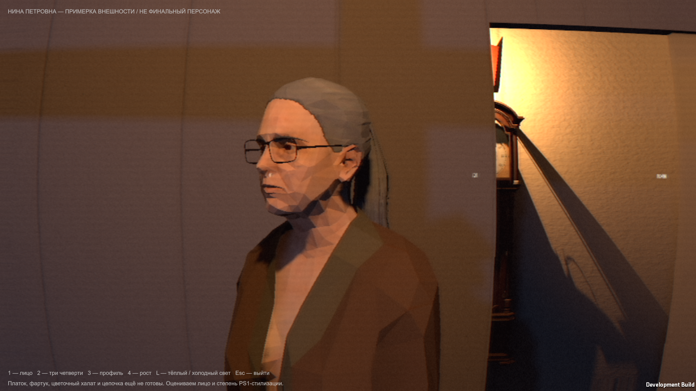

Сделано: готовая MPFB-анатомия и авторские текстуры; седые волосы, готовые очки и примерочный халат; уменьшение сетки и матовые URP-материалы; документированные авторы и лицензии. 7 автоматических кадров, errors=0. Масштаб экспорта 1.55 м. Прохождения игры этой сценой нет: она только для внешности.

**Не готово / не принято:** платок, цветочный халат, фартук, носки, цепочка; игровой риг и анимации; окончательная степень гранёности лица. Внешность Димой не принята. Плоское затенение может оказаться слишком гранёным — это предмет ревью, не заявленное достижение эталона. Отдельный кандидат ткани Sketchfab не скачался: Chrome заблокировал обе официальные загрузки, не обходили.

Claude получил новое замечание Димы; его исследование и ограничения сохранены. Источники/текущее состояние: ASSET-SHOPPING.md, CREDITS.md, docs/NINA-APPEARANCE.md. P0 тамбура и погони из review-01 остаются открыты; внешность их не заменяет. Локальная проба art16 с мебелью прошла автоядро, но уменьшенный стол/кресло обнаружены и как готовая версия не выдаются.

## 2026-10-11 — остановлена MPFB-бабушка, получена готовая Granny

Дима прямо отверг направление как слишком реалистичное и попросил готовую модель. Прекращена работа над MPFB. Исправление пересечений B проверялось в отдельном Windows-просмотре (9 кадров, errors=0), но это не художественная приёмка; последняя правка скрытых волос ещё не пересобрана. Дальнейшая доработка A/B не запланирована.

Claude признал ошибку своей трактовки о возврате к реалистичному FtF и рекомендовал готовую Granny Katcho. Проверены авторское превью и CC0 на странице/в архиве. GrampsGrannyPSX.zip скачан; оригиналы бабушки сохранены в art-sources/Katcho-Granny. Модель не изменена и пока не импортирована в игру. Нет платка/фартука — показать Диме до изменения костюма.

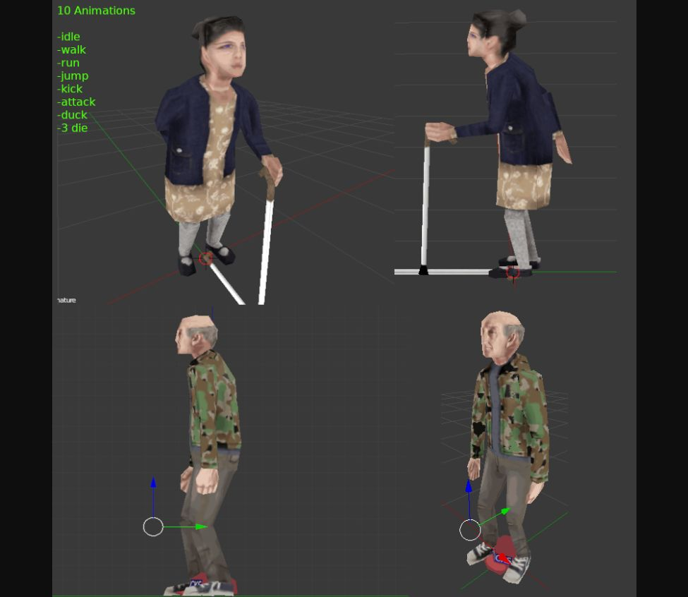

Проверено: загрузка, состав архива, лицензия, изображение автора. Не проверено: Unity-материалы, риг, 10 заявленных анимаций, масштаб, игровой проход. Свет/VHS и основное ядро не менялись; P0 из ревью остаются.

## 2026-10-11 — Дима одобрил Katcho Granny; импорт и Windows-примерка

Ответ «да норм» относится к оригинальному превью готовой Granny Katcho. Зафиксирован выбор именно этого образа. Сетка тела 456 треугольников и атлас 256×256 перенесены без переделки внешности. Есть reusable prefab NinaKatcho и отдельная GrannyReadyPreview.unity; прежнее ядро/таймлайны в этой работе не правились.

Исправлены ошибки конвертации старого Blender-файла: FBX_SCALE_ALL для единиц скелета, явный action_slot и отключение перекрывающего NLA для всех десяти авторских клипов. Исключена дублирующая неподвязанная трость, сохранена авторская трость в руке. URP-материал матовый, без перекраски. Масштаб равномерный.

Проверка работающего Windows-билда: **19 кадров, errors=0; все 10 клипов деформируют сетку; измеренный рост в idle 1.5500004 м**. Проверка роста использует реальные bone matrices/bind poses/веса в мировых координатах. Первоначальный диагностический замер ошибочно применял масштаб дважды; это исправление проверки, не увеличение персонажа. Кадры и JSON: [katcho-final](Screenshots/nina/katcho-final/result.json). Просмотрены анфас, три четверти, полный рост, холодный свет и ходьба. Это автоматическая проверка импорта и осмотр кадров, **не ручное прохождение игры**.

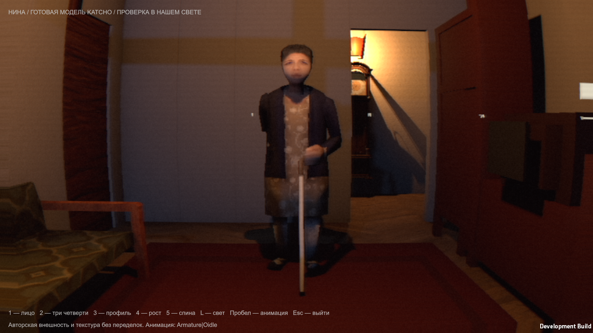

Локальный просмотр: unity-game/Builds/GrannyReadyPreview/Granny-Preview.exe. 1/2/3/4/5 — ракурсы; L — свет; пробел — авторские анимации; Esc — выход. Из копии сцены убраны маленький столик и книги, перекрывавшие ноги в портретном ракурсе. Общий свет/VHS не переделывались.

**Ограничения:** это примерка и готовый prefab, не завершённая интеграция Нины в сюжет. Авторские атаки/прыжки/смерти не заменяют SCENARIO. Родная трость немного пересекает опорную плоскость в idle (около 4 мм после масштабирования); точный контакт при ходьбе отдельно не исправлялся. P0 тамбура/старта погони, масштабы мебели и ручная проверка ядра остаются открыты. Выбранную внешность не возвращать к отвергнутому MPFB.

### Внешнее ревью Katcho f813a8e

Claude прочитал код импорта/prefab/метаданные и четыре реальных кадра. Блокеров самого импорта не нашёл; это не художественная приёмка вместо Димы. [Полный ответ](docs/reviews/2026-10-11/claude-katcho-import-review.txt).

До сюжетной интеграции: отдельная поза повешенной вместо idle, верёвка по кости шеи, одноразовые режимы постановочных клипов; сверить секунды с SCENARIO, не считать совет Claude изменением сценария. Подбородок/шея в тёплом кадре темнее лица — происхождение (свет/нормали) пока не установлено, внешний вид не перекрашивался. Комментарий о мировом измерении уточнён, поведение проверенного EXE не менялось. Диме задан вопрос о трости на полу и сохранении сценарного тапка; ответ нужен до постановки этой сцены.

Windows ZIP: builds/Nina-Katcho-preview-win64.zip, 98 626 084 байта; проверена целостность 289 записей, EXE и README на месте. Архив локальный, в исходный Git-коммит не включён. Просмотр запущен отдельно; ручной тест со стороны Димы не объявлен состоявшимся.

## 2026-10-11 — P0 тамбура, двери пятого круга и масштаба мебели

Цель возобновлена Димой; инструмент подтвердил ACTIVE. Unity-примерка Granny Katcho принята («Ну, нормас»). Общий свет/VHS и образ Katcho сохранены.

Тамбур приведён к единой геометрии с совпадающими дверями/петлями; перенос ждёт настоящего закрытия створок, которые открываются наружу от капсулы игрока. Спальня на пятом круге приоткрыта на 20 см и заперта до телефона, устранён двойной E. После погони восстанавливаются исходные состояния поверхностей/коллизий; временный непрозрачный балконный лист больше не включается. Настройки сборки восстанавливаются после BuildPlayer.

Ранее незавершённый импорт готовой мебели исправлен: стол был высотой 0.162 м вместо 0.45 м, кресло 0.569 вместо 0.85 м, диван 0.675 вместо 0.85 м. Теперь масштаб равномерный по высоте, коллайдеры соответствуют моделям. Стол развёрнут, диван отодвинут от перегородки на 10 см; книги лежат на столешнице.

**Проверено:** Unity EditMode 16/16; повторный Windows-автопрогон p0-02: шесть кругов, запертая спальня до звонка, фонарь, события, пауза, смерть/рестарт погони, часы через 42–50 с, завод и 10 ударов, возврат; **passed=true, errors=0**. [Отчёт и ограничения](QA/Scenario-P0-20261011/README.md), [журнал прохождения](QA/Scenario-P0-20261011/checks.txt). Реальные кадры до/после переноса:

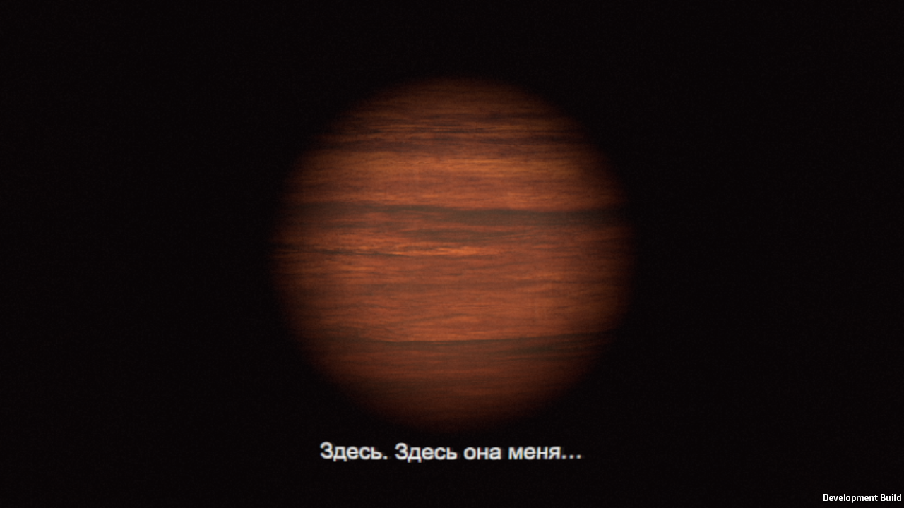
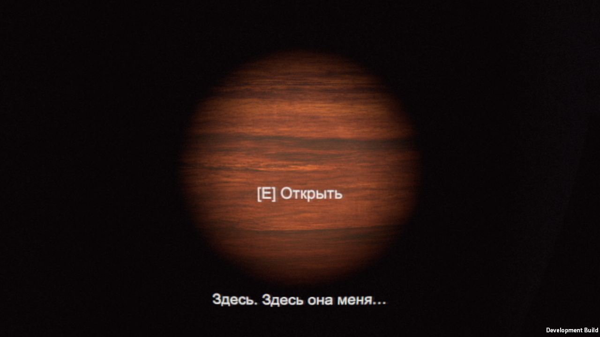

**Не проверено / не готово:** ручной клик по меню и живое прохождение человеком; полный художественный уровень; новые модели Гостьи/рук и интеграция Katcho в сцену повешенной. Открытый перенос в начале погони и схлопывание тёплого модуля в финале пока НЕ исправлены этим коммитом. Билд: unity-game/Builds/ScenarioCore/Ataka-Loop.exe, промежуточный для регрессий, не финальная игра.

Claude разобрал следующую P0: физическое продолжение прихожей Б, без видимого телепорта. [План](docs/reviews/2026-10-11/claude-chase-plan.txt). Его предложение разворота к проходу отдельно согласовано с Димой: **«Поворачивать прямо к проходу»**, SCENARIO §10.1 обновлён; 0.4 с сохранены. Часы в модулях остаются слева по §10.2, вопреки другой детали предложенного плана.

## 2026-10-11 — Entry-02: продолжение прихожей и конец погони (рабочая версия)

Старт красного коридора теперь продолжает прихожую Б; игрок остаётся в квартире до первого закрытого поворота. При сдвиге весь коридор/игрок/Гостья перемещаются вместе до обновления Cinemachine. Трёхсекундный вход содержит удары, вылет полотна и выбранный Димой поворот прямо к проходу. Тёплый модуль исключён из схлопывания; восстановление квартиры возвращает снимок света. Коллайдеры готовой мебели поворачиваются с корнем. Надписи получили шейдер с проверкой глубины.

Проверено: Unity EditMode 17/17; настоящий Windows-билд, полный программный маршрут — passed=true/errors=0. Включены смерть/повтор погони, пауза, 42–50 с, завод 2 с, десять ударов, возврат. Отчёт: [QA/Scenario-Entry-20261011](QA/Scenario-Entry-20261011/README.md).

Не принято: тамбур после изоляции света слишком тёмный, один шов остаётся >3%; временная Гостья выглядит плохо; схлопывание грубое; ручное меню не проверено из-за двух тайм-аутов Windows capture. Звук отвергнут Димой. Эта версия — сохранённая рабочая точка, не релиз и не заявление о готовности художественной части.

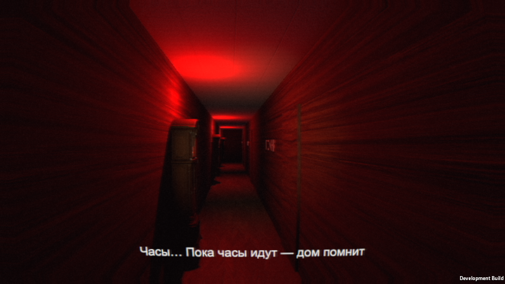
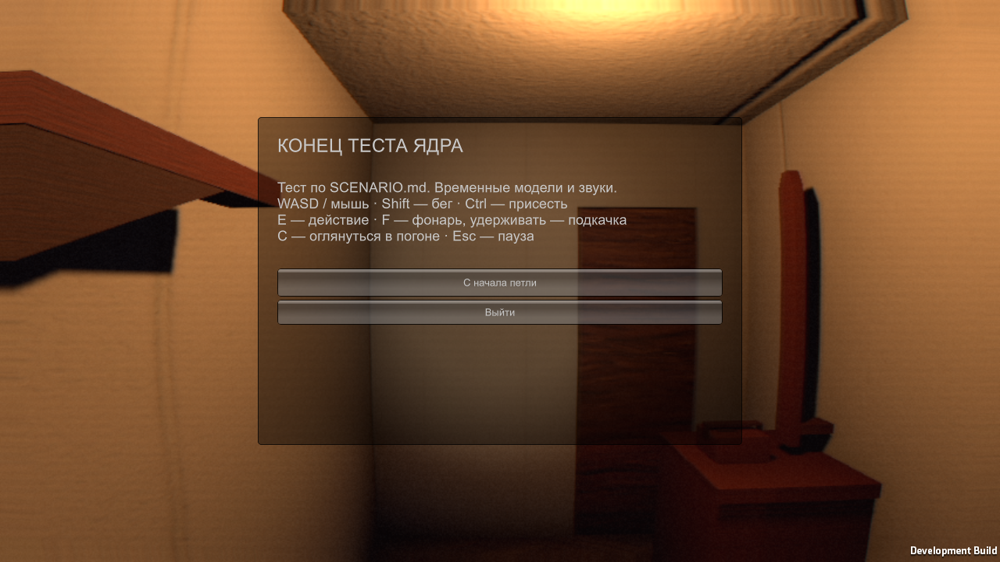
## 2026-10-11 — звук отвергнут: отдельный аудит и консультация Claude

По просьбе Димы передал Claude прямой отзыв о плохом звуке и попросил конкретно научить: записи, микширование, акустика, источники и проверка. Получен подробный план и уточнение после сверки со SCENARIO. Сохранены [AUDIO-PLAN.md](AUDIO-PLAN.md), [аудит кода](docs/AUDIO-AUDIT.md), исходные ответы в docs/reviews/2026-10-11/claude-audio-*.txt.

Подтверждены причины: sine/noise вместо фоли, один impact для разных событий, самоналожение дыхания, quiet не гасит хвосты, трубка звучит из аппарата. Следующая аудио-итерация заменяет это реальными записями и управляемыми источниками, сохраняя сценарий.

Скачаны два официальных CC0-пака Kenney; лицензии и SHA сохранены, 182 OGG успешно декодированы и измерены (tools/audio/index_sources.py). Некоторые RPG-файлы после Vorbis имеют overshoot; перед импортом нужен запас во float PCM. Это проверка файлов, не качества звучания. Claude дал первые 8 кандидатов Freesound с пофайловой проверкой CC0; три лицензии дополнительно подтверждены Codex на первичных страницах.

Ещё НЕ сделано: импорт нового материала в сцены, новый микшер/пул, записи из билда до/после, прослушивание и художественная приёмка. Не считать обновление документации исправленным звуком.
## 11.10.2026 — Recorded audio v1, рабочая интеграция

После консультации Claude заменены синтетические предметные Tone-эффекты на 56 монофайлов, подготовленных из проверенных CC0-записей. Телефон у уха, отдельное дыхание за спиной, пул 32 источников, шины микшера, ограничения наложений, шаги от пройденной дистанции, плавное приглушение мира и звук за препятствиями. Холодильник в первые круги не добавлен. Лицензии и подмены: CREDITS-AUDIO.md.

Windows-билд собран; 18/18 сценарных EditMode-тестов; автоматический маршрут меню → 6 кругов → смерть в погоне → перезапуск → возврат прошёл, ошибок 0. Записан реальный Unity listener mix до/после: потерь буфера нет, отсчётов ≥0 dBFS нет. Пик снизился с −9.34 до −17.69 dBFS: первый микс чрезмерно осторожный, нужна коррекция динамики. Это sample peak, не true peak. QA/Audio/comparison содержит шесть коротких пар без нормализации; полный отчёт QA/Audio/README.md.

НЕ проверено/не принято: качество на слух человеком, наушники/колонки, окончательные тембры и микс, реверберация комнат, все обязательные звуковые сцены. TTS-реплики временные. Исправления освещения и моделей из ревью Entry-02 остаются; звук не является поводом скрыть их. Ревью сохранено в docs/reviews/2026-10-11/claude-entry02-review.txt.
## 11.10.2026 — Audio phone v2 / получен разбор Claude

Claude проверил 027054f по коду и анализу шести пар WAV, прямо указал невозможность прослушивания. Полный разбор без посторонних частей интерфейса: docs/reviews/2026-10-11/claude-audio-v1-review.txt; план следующего прохода AUDIO-PLAN.md §9. Основные задачи: единая шкала громкости/калибровка, хвосты часов, правильные хруст/разрыв вместо дверного скрипа в смерти. Его ориентиры RMS не являются измерениями FtF.

Сразу исправлено: крик и дыхание в телефонной трубке идут 2D через HP300/LP3400, фоновые источники остаются 3D; перед очередной речевой репликой освобождается предыдущая phone_voice. Пересобран Windows-билд, 18/18 EditMode, полный автопроход снова passed=true/errors=0. Запись phone-v2: потерь 0, peak −17.85 dBFS, RMS −42.79 dBFS, отсчётов ≥0 dBFS нет. Уровни ещё не перекалиброваны. Фрагмент: QA/Audio/comparison/phone-v2-phone.wav.

Новая диагностика: максимум 14 активных источников, 52 подавленных запуска. Переполнения пула 32 не наблюдалось; без разбивки по cue нельзя утверждать, что все подавления правильные. Следующая техническая проверка — счётчики по cue/причине и сохранение важных событий. Эта версия не имеет слушательской приёмки и не объявляется окончательным звуком.
## 11.10.2026 — Audio mix v3: уровни, часы, диагностика

Убрано историческое ослабление volume/.4; источники подготовлены по типу с ограничением пиков. Записи предзагружаются, импорт не повторяет перевод в моно. Удар часов приглушает предыдущие хвосты; одновременно не больше трёх. Темп бега больше не генерирует 5.3 шага/с, теперь около 3.25. Появился изолированный калибровочный прогон на дистанции 1.5 м и диагностика подавлений по cue.

19/19 тестов, полный Windows-автопроход passed/errors=0. Пик микса −5.08 dBFS, отсчётов ≥0 dBFS и потерь записи нет. Максимум 13 источников. Вместо 52 подавлений в прежнем прогоне — одно повторное дыхание; переполнений пула 0. Все десять ударов часов начали звучать, семь старых тихих хвостов заменены. Изолированное тиканье: максимум 100 мс RMS −32.13 dBFS. Это измерения нашего микса, не подтверждение равенства FtF.

Проверки, шесть новых фрагментов, ограничения и числовые таблицы: QA/Audio/MIX-V3.md. Не принято на слух; телефонная речь ещё тихая, атака часов требует проверки, смерть всё ещё содержит неправильный дверной скрип и не содержит разрыва в 2.0 с. Следующий шаг — эти конкретные источники/события и повторное ревью Claude, затем слушательское A/B. Свет и сюжетные тайминги сохранены.
## 11.10.2026 — events-v4: звук сцены соответствует действию

- Исправлены подмены предметов: пальцы больше не звучат дверной петлёй, звон в ушах больше не женский крик. Отдельные CC0-кандидаты хруста, короткого вскрика, разрыва и tinnitus; подробные источники в CREDITS-AUDIO.md.
- Короткая смерть синхронизирована по своей версии §7.4 (хруст .3, вскрик 1, разрыв 1.5, тишина с чёрным), а не по полной семисекундной. Это исправляет ошибочное 2.0 в предыдущем отчёте. В HangingVision исчезновение в 5.0 действительно освобождает тишину до замка.
- Windows build, 19/19 EditMode, полный сценарный автопроход прошли. Реальный listener WAV и маркеры подтвердили события и тихие интервалы. Пик −6.13 dBFS, пропусков/перегруза нет. QA/Audio/EVENTS-V4.md содержит детали и ограничения. Ручного прохождения и прослушивания нет.
- Последнее уточнение Димы по бабушке: НЕ возвращать вчерашний голос — он тоже был сырым. Найти НОВЫЙ убедительный голос, подготовить образцы. Старое задание Claude остановлено и исправлено. Голосовая работа ещё не завершена, в сцену случайный кандидат не подставлен.

## 11.10.2026 — recovery-v5 и поиск голоса

Claude нашёл возврат звуков после конца/пропуска DeathShort. Исправлены освобождение звуков сцены и удержание тишины до возврата игрока. Полный Windows-автопроход, включая обычную смерть и E-пропуск, прошёл; WAV содержит цифровую тишину в обеих паузах восстановления. [Доказательства и ограничения](QA/Audio/RECOVERY-V5.md).

По просьбе Димы автотесты должны быть неслышными: QA capture теперь сохраняет исходный микс, затем зануляет выходной буфер. 24/24 EditMode, включая пять веток записи/ошибок; без изменения системной громкости и звука обычного запуска. Windows-проход после этой последней правки пока не выполнен.

Голос не принят. Две пробы Qwen отклонены по возрасту, оба Fish — отклонены. MiniMax Spirited Narrator ближе, но дикторша; speed0.88/Neutral не исправили манеру. Дима просит бытовую «бабулечку», с правильной дикцией. [История проб](QA/Audio/voice-audition/README.md); консультация Claude продолжается. В игровые сцены ничего из отвергнутого не импортировано, оплат не было.

## 11.10.2026 — сохранение тишины во время работы
Закрыты замечания Claude по запуску silent QA: до установки выходного фильтра громкость самого игрового процесса равна нулю, ошибки запуска завершают процесс, добавлен счётчик очищенных аудиобуферов. 29/29 EditMode; Windows malformed-path проверка вернула ожидаемый код 1. Сохранённый WAV проверен без проигрывания с более ранним окном тишины +30 мс. Правки не означают принятия звучания.

Последний отзыв Димы о голосе: MiniMax всё ещё дикторский. Требуется бытовая пожилая манера («бабулечка»), вчерашний Piper — только сравнение, не вариант для возврата. Автопроигрывание и новые звуковые прогоны через колонки запрещены, пока Дима играет с другом. Текущий голос не интегрирован.

## 11.10.2026 — художественный результат отклонён; пакет для строгого ревью
Дима отверг общую картину квартиры и повешенную бабушку: неверное ощущение пространства, шкаф у открытой двери, неубедительная постановка. Передано прямое поручение Claude активно проверять все реальные кадры и давать конкретные исправления. Новые фичи отложены. Сохранённый LightLab не менялся.

Собраны 38 оригинальных кадров 1280×720: Screenshots/art-review-01/README.md, камеры/условия в survey.json, хеши в manifest.json. Это QA-камеры с открытыми дверями, не ручное прохождение. Ещё 14 кадров текущего целевого прогона пятого круга: Screenshots/scenario/nina-integrated-04. Неудачные ракурсы не отфильтрованы. Claude готовит сопоставимые кадры v3.

Технические изменения до ревью: ранее одобренная Katcho встроена вместо временной модели, статическая поза на существующем скелете; E открывает дверь, отсчёт сцены начинается после входа с видимостью тела. Собственные коллайдеры игрока исключены из проверки видимости; реальные препятствия учитываются. Табуретка сдвинута до x=1.95, так как закрывала ноги. Новых мешей и света нет. Windows-сборка успешна; 31/31 EditMode (до последнего сдвига табуретки и добавления обзорных камер). Целевой прогон nina-integrated-04: passed=true/errors=0/lap=5/chase=false. Это НЕ полный маршрут и НЕ художественная приёмка. Предыдущий nina-integrated-03 остановился у входа в сцену; чёрные кадры скрытого окна 01 для оценки не используются.

Визуально проверены оригиналы 1.1, 2.6, 3.6, 4.6, 5.1: силуэт и поворот бабушки ещё неубедительны, прямой подвес плохо читается, мебель выглядит грубой. Дверь/шкаф и композиция требуют исправления по ревью. Кухня и комнаты не завершены. Ручного прохождения человеком и проверки звука нет; автоматическая запись вывода выполнялась с занулением буфера, звук не проигрывался. Голос MiniMax не принят; Voice Design только подготовлен, генерация не запущена.

## 11.10.2026 — ревью Claude и первая правка спальни
Claude просмотрел 52 исходных кадра и подготовил 10 сравнительных листов, затем 4 листа готовых моделей. Полный разбор: [README](docs/reviews/2026-10-11/claude-art-review-01/README.md), [ассеты](docs/reviews/2026-10-11/claude-art-review-01/ADDENDUM-ready-assets.md). Это план исправлений, не приёмка. Процедурная мебель M1 — только ориентир композиции.

Дима разрешил перенос шифоньера и затем прямо делегировал Claude решения по расстановке и постановке, включая расхождения со SCENARIO. Шифоньер перенесён к боковой стене; вход освобождён. Подвес смещён над свободным полом, немного изменена поза существующего скелета Katcho, без изменения костюма. SCENARIO обновлён. Сохранённый LightLab не менялся.

Проверено: Windows build успешен; аудит прохода капсулой диаметром 0.44 м при закрытых и открытых створках — PASS (не доказательство ширины 0.8 м); автоматическое прохождение 6 кругов, смерти/пропуска и погони до тёплого возвращения — passed=true/errors=0. Исходные кадры: Screenshots/scenario/art-review-02. Повторная обзорная съёмка: Screenshots/art-review-02-visible (38 кадров, те же позиции и условия, что art-review-01). Скрытое окно art-review-02 дало чёрные кадры: отклонено, в сравнения не включается. Тесты с занулением аудиовыхода, без прослушивания.

Визуально проверены новая дверь, HangingVision 2.6 и 4.3: вход лучше, но художественная задача НЕ решена. Руки сливаются, ступни всё ещё читаются как опора, верёвка похожа на прямой стержень, открытая дверь теснит композицию. Материалы и большинство предметов квартиры ещё нуждаются в замене по ревью. Ручного прохождения человеком, аппаратной проверки звукового выхода и принятия внешности сцены нет. Следующий шаг: повторное ревью Claude этих оригиналов, затем исправление постановки и готовые ассеты.

### Готовая табуретка по подборке Claude
Вместо Kenney stoolBar в сюжетном реквизите установлена painted_wooden_stool (Kirill Sannikov / Poly Haven CC0). Оригинальные FBX и UV, авторские diffuse/normal; текстуры ограничены 512 px с bilinear. Размер после равномерного масштаба: 0.2991 × 0.4500 × 0.3156 м. Положение опрокинутого предмета вычисляется по фактической нижней границе рендереров: 4 мм над полом, вместо прежней произвольной высоты. Источник и контрольные MD5 сохранены возле модели, автор добавлен в CREDITS.
Windows-сборка прошла. Целевой беззвучный тест ready-stool-01 прошёл до выхода из круга 5, errors=0. Это не повтор полного маршрута. Проверены игровые кадры 1.1 и 5.1: табуретка теперь читается как потёртый бытовой предмет, ноги бабушки не перекрывает; на кадре после исчезновения камера всё ещё смотрит слишком высоко, это остаётся дефектом постановки. Остальная мебель/сцена не приняты.

Уточнение Claude по кадрам iteration-02: оранжевая плоскость, ранее ошибочно названная дверью, — торец шкафа Kenney. Вывод про тесный кадр остаётся, причина исправлена. Нельзя лечить это только поворотом двери.

### Постановка 03 по второму разбору Claude
Полный разбор: docs/reviews/2026-10-11/claude-art-review-02/README.md. Шкаф сдвинут к окну до z=1.80; шея поднята до 1.72, скорректированы существующие кости рук/стоп/головы, добавлены небольшое качание и более поздний разворот. Оранжевый LineRenderer заменён 8-гранной верёвкой диаметром 16 мм с петлёй, узлом и хвостом; собственная шумовая фактура, цвет пеньки. Это разрешённая Claude геометрия сценического реквизита, не новая мебель или персонаж. Камера поднимается до плеч, после исчезновения опускается к реквизиту. Готовая табуретка перемещена по D1. Свет/грейд LightLab не менялись.

Windows-сборки успешны. Целевой игровой автотест staging03 прошёл: lap=5, passed=true, errors=0. Дополнительная матрица из двух заданных Claude точек — постановочная QA-съёмка, НЕ прохождение. Боковой вид — диагностический: другие стены/мебель скрыты, существующий фонарь перемещён к ортографической камере. Первый боковой кадр слишком тёмный из-за перезаписи направления фонаря сценой; исправлено отдельным поздним обновлением только в QA-режиме, новая папка staging03-matrix-lit.

Измерение запечённых вершин персонажа: нижняя точка 0.3719 м над полом в диагностической позе (не координата кости). Просвет кистей 8 см ещё не доказан. На реальных кадрах4.3 лицо теперь не раскрывается в фас, но в1.1 табуретка визуально совпадает со ступнями — нуждается в коррекции по повторному ревью. Верёвка требует близкого осмотра узла.

Не сделано: C3 потолочный патрон/лампочка; D2 настоящий отдельный тапок; F лампадка/иконы; G замены шкафа, кровати, текстиля, дверей/окна/батареи; кухонная табуретка пока старый прокси. Пальцы модели не имеют отдельной правки. Матрица из второй точки содержит оставшуюся после первой сцены реплику, это особенность диагностического прогона с отключённым LoopDirector, не доказательство появления реплики в обычной игре. В журнале матрицы есть предупреждение URP об уменьшении разрешения теней под атлас; художественной приёмки и заявления о стабильном FPS нет. Всё выполнялось без прослушивания.

### 11.10 — Постановка04 и готовая металлическая кровать
Руководство: полный разбор03 Claude сохранён с SHA256 в docs/reviews/2026-10-11/claude-art-review-03. Дима делегировал ему расстановку; дополнительных вопросов о каждом предметe нет.

Сделано:
- Сохранены принятые Claude поза головы/рук и поздний разворот. Подвес переведён с шеи на узел +x, кольцо поднято под челюсть. Сам костюм Katcho не менялся.
- Табуретка выставляется по центру фактических повёрнутых bounds (1.40, пол, 2.55), ножки к кровати. Первоначальная попытка ошибочно позиционировала pivot и смещала предмет на22.5см — исправлено.
- Брусок-тапок заменён одним целым тапком автора headless_christ, CC-BY4, длина28см. Обувь Katcho — часть общей сетки: по решению Claude отдельный тапок виден после5.0.
- Капля и мокрый след с2.0: нижняя точка правой туфли берётся из фактической запечённой сетки, не из кости щиколотки. В существующем банке нет подходящего «кап»; звук не подменялся случайным эффектом.
- Входной триггер на пороге x<2.70 с LOS; вторая точка съёмки (2.62,3.40). В QA исправлена оставшаяся от предыдущего дубля реплика.
- Kenney bedSingle и подушка удалены. Готовая old_bed_frame / Luca B / Poly Haven / CC0:0.904×2.00×1.20м. На ней разрешённый Claude текстиль: матрас, покрывало,3 подушки. Исходные ткани отдельно скопированы, ограничены512px и обесцвечены настройками импортера; исходные общие текстуры/LightLab не менялись.
- Исправлены обнаруженные на первых кадрах жёлтая ткань, подушки у изножья, зазор в стопке и пересечение покрывала с матрасом. Матрас установлен над измеренной пружинной сеткой (.49–.50м). Лампадка сдвинута с(.15,.15) до(.22,.22), её интенсивность и грейд не менялись.

Проверено:
- Windows build: Logs/staging04-delivery-build.log, Success.
- Полный автоматический маршрут staging04-full:6 кругов, погоня, пауза часов, смерть от остановки, повторная смерть/пропуск E, тёплые часы в42–50сек,10 ударов и возврат; passed=true, errors=0. Этот прогон выполнен ДО последних локальных поправок центра табуретки/высоты постели.
- После этих поправок и устранения пересечения ткани: целевой игровой маршрут staging04-delivery-route от меню/фонарика через сцену до открытого выхода круга5 — passed=true, errors=0.
- staging04-delivery-matrix:12 кадров (6 моментов ×2 пороговые точки) + боковая диагностика. Боковой кадр с временным нейтральным QA-светом и скрытой геометрией; это НЕ обычный игровой вид. Нижняя вершина персонажа по измерению .3719м над полом.
- Ни ручное человеческое прохождение, ни прослушивание не проводились. Все запуски использовали silent audio-capture; общая громкость компьютера не менялась.

Остаётся: критерий экранного зазора табуретки10%, художественная читаемость капли и тапка, кружевная накидка, белая дверь, патрон с лампочкой и готовый шифоньер. Подушки/покрывало требуют оценки Claude по кадрам; фотогеничность готовой рамы не равна принятию всей комнаты. В логах сохраняются предупреждения URP о снижении разрешения теней; стабильный FPS не заявляется.

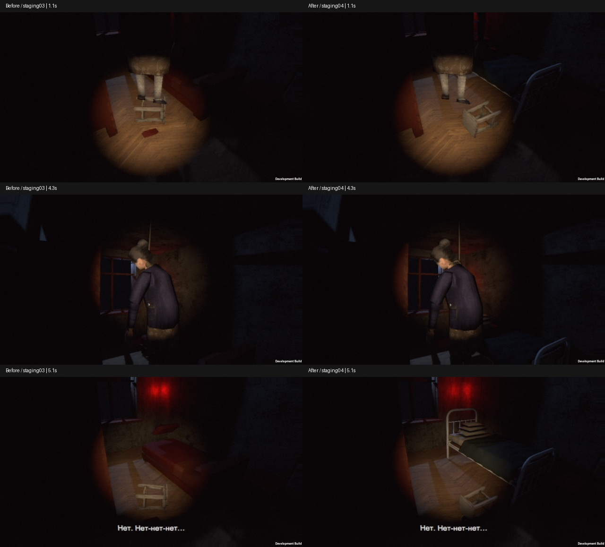

Дополнительно сохранён полный обзор38 камер: Screenshots/art-review-04/survey.json описывает позиции и ограничения. Это постановочные QA-камеры в штатных lap1/warm-return, с открытыми дверями и отключёнными событиями; не доказательство проходимости. На кадре спальни видно, что лампадка всё ещё образует два красных пятна — перенос8см не решил F1 окончательно, передано Claude.

### 11.10 — Пакет05 спальни: готовые ассеты, контрольная версия

Готовые шифоньер dashkilya, рамы/патрон/лампочка Poly Haven, CC0-кружево Katsukagi; белые филёнчатые двери, обои/ковёр, обновлённый разрешённый текстиль, spot лампадки, след и тапок. Поза/верёвка и грейд LightLab сохранены. Полный состав и лицензии — CREDITS и docs/reviews/2026-10-11/claude-art-review-04/IMPLEMENTATION-NOTES.md.

Сборка Windows прошла, вход0.44м проверен. Три полных автоматических прогона выявили сначала точку шкафа (исправлено), затем устаревшую ссылку погони (исправлено), затем выдавливание героя открывающейся дверью под ковром на5 круге (НЕ исправлено). Изолированная погоня также не прошла ожидание смерти, errors=0. Поэтому НЕ выдаётся готовый игровой билд. Ручного прохождения и прослушивания не было, все тесты беззвучные.

Сохранены46 обзорных и13 постановочных кадров. Визуальные замечания: чёрные подушки, неубедительная вазочка вместо лампадки, слабая читаемость мокрого следа. Нужны решения Claude по фактическим кадрам. Подробности: docs/reviews/2026-10-11/bedroom05-submission/README.md.

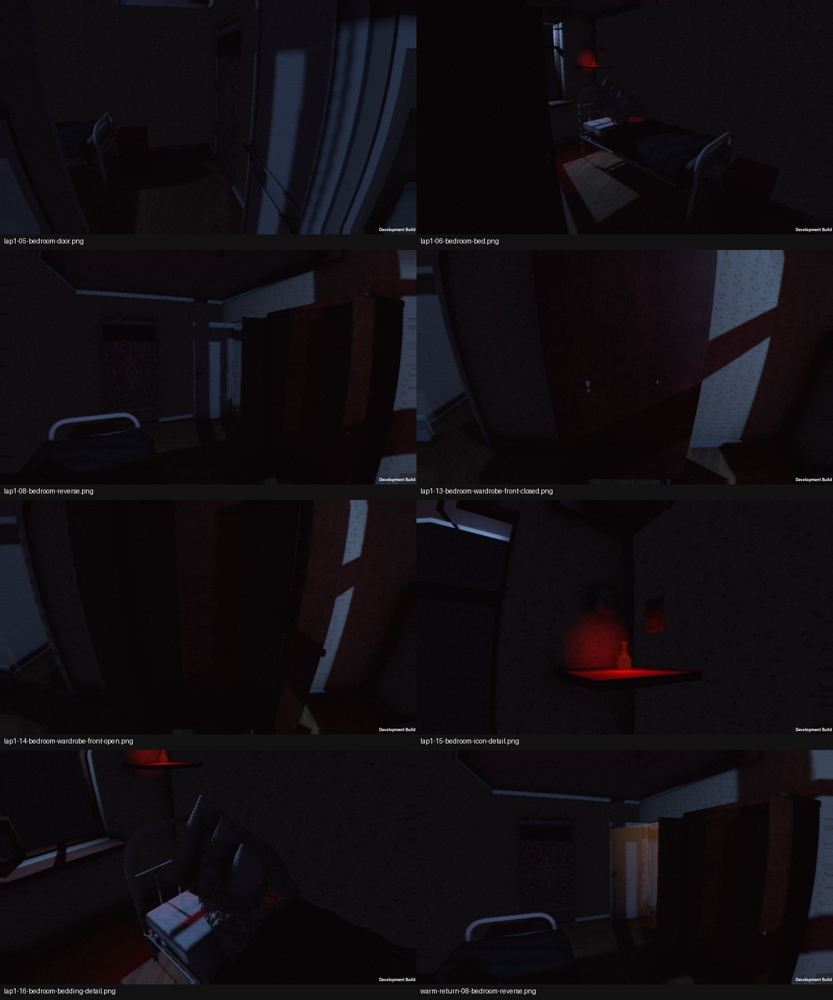

Уточнение проверки погони: shortcut -scenario-chase-only оставлял игрока в обычном месте старта, а не у входной двери перед погоней. Исправлен только setup QA: круг6, фонарь, позиция(8.05,.02,5.35), взгляд к проходу. Реальная механика не менялась. Повтор bedroom05-chase-setupfix: passed=true/errors=0, смерть от остановки, пропуск повторной смерти, поворот без отставания камеры, тёплые часы42–50сек, завод и10ударов, возврат. Это подтверждает изолированную погоню; весь маршрут до неё всё ещё блокирует дверь5 круга.

### Пакет06 / P0: промежуточная проверка и ограничение фокуса
Claude review05 (SHA618c4a4d2c40b10300c1df776d05fb49d6c3dead56afb42fadbf6b173afd460c) принят к работе. Тумбочка перенесена к изголовью(1.22,0,1), направление двери в спальню сохранено. Guard на OverlapBox добавлен для всех ScenarioDoor;4 EditMode-проверки прошли, но последующий игровой probe НЕ прошёл: позиция(.86,.01,3.75)→(.52,.02,3.52) после2сек, угол69.75°. Динамический подход и переход в круг2 прошли. Поэтому исправление НЕ объявляется готовым; редакторский тест оказался недостаточным.

Дима сообщил, что новые окна Unity/билда сворачивают его другую игру. Новые GUI/GPU-запуски остановлены, работа продолжается без новых окон и аудио. Следующую визуальную проверку не проводить до разрешения на такой запуск либо проверенного способа без перехвата фокуса. Не обещать, что Hidden гарантирует отсутствие фокуса; ранее он давал чёрные кадры.

### Продолжение без перехвата фокуса
- Новая версия защиты двери проверяет текущую капсулу героя относительно створки напрямую, с зазором 2 см и промежуточными углами не больше 1°. Консольная компиляция Ataka.Runtime прошла (59 исходников); Unity и игрок не запускались. Это НЕ подтверждает исправление физики: нужен повтор bedroom06-door-probe, когда запуск не будет мешать Диме.
- tools/qa/compile_without_editor.py использует последний Unity response file и пишет DLL отдельно в QA/NoWindowCompile. Library/Bee не заменяется.
- Разрешённый текстиль переэкспортирован Blender --background через CREATE_NO_WINDOW: углы подушек скруглены на 4 см, выпуклость 5 см; кружево уменьшено. Экспорт и геометрические размеры проверены, импорт/визуал в Unity пока нет.
- Подготовлен дополнительный одинаковый ракурс без кружева для сравнения. Новые скриншоты НЕ снимались. Старые тесты первой версии OverlapBox нельзя считать проверкой новой реализации.
- При дальнейшей работе сохранять запрет новых GUI-окон, перехвата фокуса и слышимого тестового аудио. Не закрывать неизвестные процессы Unity или игру пользователя. Наличие старого окна само по себе не разрешает его активировать.

### 11.10 — спальня06: подготовка ассетов без окон
Готовый будильник Poly Haven/CC0 скачан с проверкой размеров и MD5; измерен авторский масштаб13.17 ×6.67 ×17.42см. Разрешённая Claude лампадка экспортирована фоновым Blender (CREATE_NO_WINDOW). Подготовлена явная, ещё НЕ выполненная команда ApplyPreparedArt для красного угла/будильника. Сохранены принятые цвет/интенсивность главного света и поза персонажа. Стакан, очки и таблетки остаются незаполненными позициями.

Мокрый след заменён в коде на умножение освещённого пола0.55 с мягким неровным краем и3 мелкими каплями. Runtime59 исходников и Editor33 исходника компилируются консольным Roslyn без Unity. GPU-шейдер, фактический вид и исправление двери НЕ проверены; готовый билд не заявляется. Повторный доступ к чату Claude через существующую вкладку завершился ошибкой JSON/HTML до чтения страницы; сообщение сохранено как неотправленный черновик.

### 12.10 — готовые очки и синхронный будильник, без окон
Из уже скачанного CC0-набора экспортированы отдельные очки MRT/MargaretToigo, ширина14см; внешность Katcho не менялась. В отложенный BedroomArt06 добавлены размещение на тумбочке и проверки края, высоты опоры и пересечения с будильником. Обнаружено требование SCENARIO об общем времени всех часов: подготовлена привязка авторских стрелок будильника к flat.clock, через необязательный ClockFace.timeSource.

Консольная компиляция Runtime59/Editor33 прошла; Editor проверен со свежей локальной ссылкой Runtime и хешами исходников. Unity-установка, положение/вращение стрелок, прозрачность очков и физика НЕ проверены. Кандидат готового стакана CC0 требует входа в BlendSwap, записан в ASSET-SHOPPING. Никаких новых окон, воспроизведения звука или перехвата фокуса не было. Повторная диагностика браузера: Chrome обнаружен, список вкладок возвращает ошибку HTML/JSON, сообщение Claude не отправлено. Подробности: docs/reviews/2026-10-12/bedside-preparation/README.md.

### 12.10 — реальная физика без окна и установка спальни06
Официальный Unity -batchmode -nographics отработал с Null graphics и MainWindowHandle0, без игрока/рендера/аудио. Новый guard сначала провалил3/4 теста из-за Quaternion.Angle: малые шаги сглаживания отбрасывались и дверь застревала примерно за1° до цели. Исправлена метрика малых углов. Итоговый набор7/7: четыре исходных позиции/направления/шаги, отдельная сходимость, два порядка native CharacterController.Move под гравитацией. Координаты до/после(0.86,0.01,3.75), срок продолжения открывания после отхода1сек. Полное прохождение ещё не выполнено.

Спальня06 установлена в сцену. Исправлены реальные ошибки импорта единиц FBX, скелетных стрелок будильника и перезаписи базовой ориентации очков. Авторский будильник переведён в жёсткие меши вокруг авторских осей, UV/форма сохранены. Размеры и опора обоих предметов прошли проверки; световой грейд/поза персонажа не менялись. Никакого визуального принятия: NullGfx не проверяет картинку, а URP оставил ошибку ресурса TraceRenderingLayerMask.urtshader. Стакан и таблетки всё ещё отсутствуют.

Первый повтор после аварийного exit1 был отклонён авто-проверкой: неизвестные Unity-процессы и оставшийся lock-файл. Read-only WMI установил, что это только Hub/helper без projectPath; Editor завершён, lock никем не удерживается. После предоставления этих доказательств повтор одобрен с OS-проверкой эксклюзивного открытия. Lock не удалялся, чужие процессы не трогались. Полный пакет: docs/reviews/2026-10-12/headless-door-and-placement/README.md.

### 12.10 — полный Windows runtime-прогон без окна/звука
Добавлен QA-режим -scenario-headless: Null graphics, AudioListener.volume0 до Awake, виртуальные клавиатура/мышь только внутри процесса; в batchmode не трогаем Cursor. Сборка через headless_unity, без AutoRun; все наблюдавшиеся собственные процессы имели MainWindowHandle0. Финальный однокадровый переход в этом режиме ждёт Update вместо отсутствующего окончания рендера. Обычный видимый запуск сохраняет прежнее поведение.

Дверь прошла отдельный runtime-probe: неподвижный герой не сдвинут, движущийся не вытолкнут, дооткрытие<=1сек, закрытие/перенос в круг2. Первый тест ошибочно сам пересёк переход раньше времени; провал сохранён, маршрут теста исправлен. Первый полный прогон дошёл через6кругов до погони и провалился на неверной фазе измерения камеры; наблюдение перенесено после обычного Cinemachine LateUpdate, камера не принуждается к позиции.

Повторный ПОЛНЫЙ прогон прошёл: все6кругов, видимость сцены5, пауза, смерть/перезапуск, пропуск повторной смерти, камера без отставания (gap0 в том же кадре), тёплый модуль42–50сек, завод2сек,10ударов, возврат. Будильник следует времени всех6кругов и финала. Runtime errors0, coreFinished=true. Это НЕ проверка графики, звука или человеческое принятие. Код/история провалов/результаты: docs/reviews/2026-10-12/headless-runtime.

Вкладка Claude по-прежнему недоступна через браузерный инструмент (HTML вместо JSON); сообщения не отправлены. Новые окна, перехват фокуса и слышимые прогоны не выполнялись.

### 12.10 — готовые стакан/капсулы и повторный тихий прогон
На тумбочке установлены готовые CC0-модели DREAM_SEARCH_REPEAT и Marcus-Indrek Simmer: стакан10см, две капсулы18мм. Масштаб, опора и отсутствие пересечений проверены в Unity; принятые свет, будильник, очки и поза сохранены. Первый импорт обнаружил сброс имени prefab при повторном импорте, провал сохранён; после unpack повтор прошёл. Новая Windows-сборка прошла 43 runtime-проверки всего ядра, errors0, coreFinished=true. Null graphics и громкость0; новых GUI-окон, фокуса и слышимых тестов не было.

Пакет доказательств: docs/reviews/2026-10-12/bedside-completion. Новая ZIP-копия сохранена отдельно, прежняя не перезаписана. CPU-превью стекла обозначены именно как Blender-диагностика; Unity-прозрачность/кадры, голос и художественное принятие ещё не проверены. Claude через существующую вкладку недоступен (HTML/JSON); черновик не отправлен.

### 12.10 — снова разрешены окна; реальный графический проход
После явного разрешения Димы сняты48 обзорных кадров и70 кадров полного игрового маршрута на Direct3D11. Полный прогон прошёл43 проверки, errors0/coreFinished=true. Аудиовыход очищен8633 раз, droppedSamples0; звук пользователю не включался. Кадры/контактный лист: docs/reviews/2026-10-12/bedroom06-rendered.

Дополнительные9 диагностических кадров показали: отключение кружева или карты нормалей не устраняет тёмные фасады подушек, а направленный фонарь делает тот же материал светлым. Основная причина — освещение поверхности, поэтому принятый свет не меняем. На крупном плане стакан мутный; выполняется ограниченная правка альфы стекла/воды с сохранённым до/после. Это не художественная приёмка. Попытка чтения согласованного Chrome через Computer Use была остановлена проверкой: текущий URL не определён достаточно надёжно. Сообщение Claude не отправлено, обход не выполнялся.

### 12.10 — итоговая проверка стекла и графического билда
После уменьшения alpha стекла0.14→0.045 и воды0.075→0.02 сняты9 одинаковых диагностических ракурсов. Изменение ограничено прозрачностью, свет/VHS/поза сохранены. Стакан менее мутный, окончательный вид оставлен на арт-ревью. Финальный билд снова прошёл весь маршрут с Direct3D11:43 проверки,69 оригинальных кадров, errors0/coreFinished=true. Звук очищался в listener capture, пропусков0. ZIP сохранён отдельно с CRC и SHA; старые архивы сохранены. Это рабочее ядро, НЕ готовая игра и НЕ художественное принятие.

### 12.10 — повторно получен review05: закрыты пропущенные пункты
Повторный аудит обнаружил, что безопасная дверь ещё не давала щелчок/щель при ограничении<20°, а белый «брус» был открытой частью матраса. Добавлены общий ToggleWithCue и безопасное приоткрывание до5° с прежней защитой от капсулы; после отхода цель95°. Существующее покрывало продолжено к изголовью, без изменения кровати/подушек/позы. Принятые свет/VHS сохранены.

8/8 физических EditMode-тестов, отдельный реальный GPU door-probe и полный Windows-маршрут прошли:43 PASS, errors0,6кругов/погоня/возврат;70 игровых кадров. Дополнительно50 обзорных и12 диагностических. Без света икон красный оттенок исчезает, но тёмная полоса остаётся; точный отбрасывающий объект не изолирован, текстурной красной полосы нет. Подушки остаются тёмными спереди при штатном свете; диагностический фонарь не выдаётся за основной свет. Рендер сообщает уменьшение разрешения дополнительных теней под4096атлас — это сохранённое ограничение, не скрытая ошибка.

Новая ZIP-копия Ataka-bedroom06-review05-complete-win64.zip проверена CRC/SHA, прежний билд сохранён. Доказательства: docs/reviews/2026-10-12/bedroom06-review05-completion. Звук QA заглушён,8518 очищенных callbacks, dropped0. Ни человеческого прохождения, ни нового одобрения Claude/голоса не заявляем. Чат Claude снова недоступен (HTML вместоJSON); обновлённый запрос НЕ отправлен. Следующая комната по переданному review05 — прихожая, готовые ассеты из его списка; нового сюжета не придумывать.

### 12.10 — review06 и диагностика покрывала
Claude ответил по cf00934. Скорректированы ткань, наклон/габариты подушек, обратная нормаль кружева, диагональный красный угол и материал стекла. Изолирован источник «ступеней»: при отключении только теней авторского железного каркаса полосы исчезают. Игровые тени сохранены. 50 обзорных и15 диагностических кадров; первый полный графический маршрут43PASS/errors0, но перенос тапка к табуретке визуально неудачен — кадр сохранён как rejected, позиция исправляется с повторным проходом. Белая коробочка лекарств/художественная приёмка/голос ещё не готовы.

12.10 — итог bedroom07/review06: перенос тапка к табуретке перекрывал его, поэтому новая позиция(1.75,.004,2.32) даёт отдельно видимые тапок/след/табуретку. В промежуточной правке поймана и устранена порча UTF-8; окончательный diff ScenarioTimeline — только одна координата. Финальный Direct3D11-проход43PASS/errors0/coreFinished, 70 кадров; 8517 очищенных аудиобуферов, dropped0. CRC/SHA нового отдельного ZIP сохранены. Проверены ключевые15/16/18/warm06/1.1/5.1 и диагностические кадры; не заявляю покадровый просмотр всех файлов. Прихожая, коробочка лекарств и художественное принятие спальни ещё впереди. [Сравнение до/после](docs/reviews/2026-10-12/bedroom07-review06-iteration/before-after.jpg), [диагностика теней](docs/reviews/2026-10-12/bedroom07-review06-iteration/bed-shadow-diagnosis.jpg).

### 12.10 — review07: стопка подушек и компактный красный угол
Прочитан подтверждённый ответ Claude07 по341d772. Он отменил прежнее задание на наклонные подушки, принял тени каркаса/стакан/тапок/след и направил после правок к прихожей. Сделана лежащая стопка, полка35см, halo вдвое слабее, кронштейн до стены; основные свет/VHS/поза не изменены. Две неудачные формы сохранены, исправлены видимые зазоры и угловые выступы; художественное принятие итогового объёма ещё ожидается.
Финальный Windows Direct3D11-проход43PASS/errors0/coreFinished=true;50обзорных+15диагностических+70маршрутныхкадров. QA-вывод звука заглушён,8512callbacks,dropped0; аудиоприёмки нет. [Кадры до/после](docs/reviews/2026-10-12/bedroom08-review07-iteration/before-after.jpg). Отдельный ZIPAtaka-bedroom08-review07-win64.zip проверен CRC/SHA; предыдущий сохранён. Подготовлен готовый dirty-комплект сапог PolyHaven CC0 для прихожей, ещё не установлен. Трюмо/телефон/вешалка, голос и полная игра остаются в работе.

12.10 — запрос доставлен Claude, получен review08: проверилREADME+3оригинала93e3d09, принял спальню для перехода к прихожей. Пухлость ткани вблизи отложена; план прихожей06 подтверждён, грязные сапоги подходят. Полный ответ сохранён рабочей записью вdocs/reviews/2026-10-12/claude-review-08. Личный тест Димы не заменён ревью.

### 12.10 — Hall09: трюмо, телефон, обувь, вешалка
Продолжение после закрытия спальни Claude review08. Установлены готовые Dresser/VEF/rubber_boots/тапки/HookRack, лицензии в CREDITS. Фонарь берётся из правого отделения двумя взаимодействиями, безопасное автозакрытие/пауза. Реальные размеры трюмо и высота дна уточнены без растягивания модели. Старые наложенные Kenney-предметы удалены по границам геометрии, исправлены WebP под видом PNG и разворот вешалки.

Проверено: Windows Direct3D11, hall-probe10PASS, полный маршрут 50PASS/errors0/coreFinished, 50 survey-кадров, молчащий QA-аудиовывод. Принятые свет/VHS/спальня сохранены. Пакет: docs/reviews/2026-10-12/hall09-ready-assets/README.md, before-after.jpg, оригиналы, отрицательные итерации и build-manifest. Архив builds/Ataka-hall09-ready-props-win64.zip. Предыдущий архив сохранён.

Не проверено/не готово: человеческое ощущение игры, качество новых голосов, художественная приёмка Claude. В тёмном круге фонарь внутри тумбы плохо читается; рядом с телефоном иногда видна подсказка соседней двери. Все секции зеркала пока используют одну плоскость, модели Миши в нём нет. Остальные комнаты ещё содержат временные предметы. Это промежуточный пакет, вся игра не завершена.

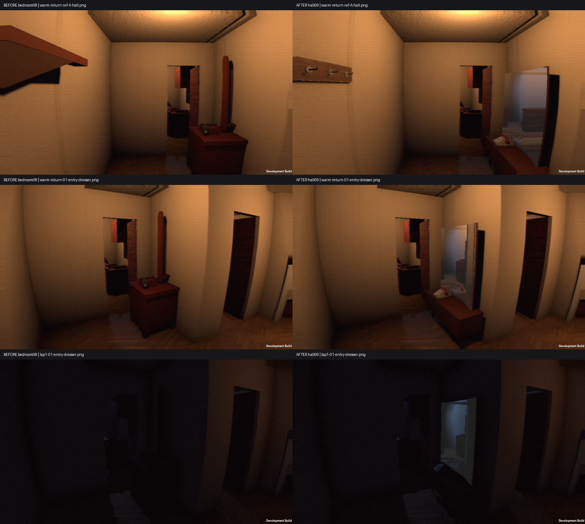

Получен Claude review09 по68e6030: отдельные готовые предметы приняты, вся прихожая не принята. Зеркало P0 выглядит экраном; временно заменить на мутное probe до появления Миши. Следом читаемость фонаря без изменения света и ошибка приоритета E. Подробный ответ и точный объём просмотренных кадров: docs/reviews/2026-10-12/claude-review-09/README.md. Архив Hall09 остаётся промежуточным checkpoint с перечисленными дефектами.

## 12.10.2026 — Hall10, частичное исполнение review09
Заменено planar-зеркало на мутные HDR probe-секции; устранена причина неработающего realtime capture (QualitySettings), добавлено обновление после светового профиля. Фонарь перенесён/материалы настроены, но в обычной темноте он всё ещё плохо читается. Приоритет взаимодействий по физическому лучу убрал Закрыто на телефоне. Свет/VHS/спальня сохранены. Windows полный путь50PASS/errors0/coreFinished, hall12PASS,135кадров суммарно; QA без слышимого звука, не прослушивание. Новый отдельныйZIP и SHA в docs/reviews/2026-10-12/hall10-review09-corrections/build-manifest.json. Художественное принятие отсутствует; готовится ревью Claude по оригиналам, включая нерешённый фонарь.

## 2026-10-12 — Apartment11: общий вид вместо микроитераций
Дима отверг порядок зеркала/фонаря/подушек. Передано Claude, приоритет исправлен в ACTIVE-GOAL. Выполнен первый крупный проход отделки зала/кухни/прихожей/ванной, готовые плита/холодильник/стол/сервант/ТВ, крупный настенный ковёр, масштаб стола. Принятые Light/VHS не менялись. Исправлены ошибки осей FBX и чтения specular-glossiness GLB; промежуточные прогоны не выдавались за готовность.

Проверка: Windows D3D11 50 PASS, errors0, coreFinished,50 обзорных+73 маршрутных кадра, тихий аудиовывод. Есть URP shadow-atlas warning. Человеческой и художественной приёмки нет. Окна/двор/шторы, часть крупных заглушек и обивка ещё требуют работы.

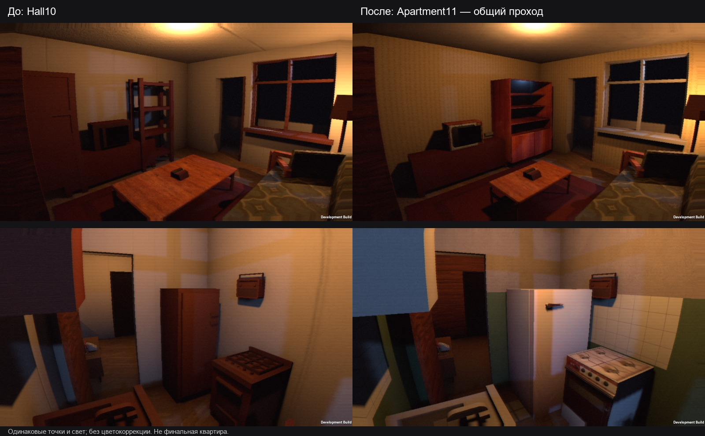

Пакет: docs/reviews/2026-10-12/apartment11/README.md. Билд: builds/Ataka-apartment11-win64.zip; предыдущий Hall10 сохранён.

## 12.10 — Apartment12: окна и общий вид

- Во все окна добавлен существующий двор M1: дом напротив, дальние корпуса, мокрое покрытие, остатки снега, фонари. Наружный туман и цвет применяются отдельным шейдером только к двору; глобальный fog комнаты не изменён.
- Тюль и портьеры из существующих материалов M1, разрешённая геометрия ткани. Стол покрыт клеёнкой. Прихожая получила светлые обои вместо тёмного шпона и дорожку.
- При блэкауте внешняя электрическая подсветка меняет intensity и параметр материала, без выключения объектов. Принятые внутренние Light/VHS проверены до/после сериализацией и не изменены.
- Камера ванной перенесена к двери согласно review11. Кадр теперь показывает сантехнику, но она по-прежнему грубая и слишком тёмная.

## Проверено
Windows Direct3D11, обзор 50 кадров и полный автоматический маршрут от меню до конца ядра: 50 PASS, coreFinished=true. Исходные кадры и результаты приложены. Runtime SHA совпадает в обзоре, маршруте и архиве. ZIP проверен CRC. QA заглушает собственный аудиовывод; человеческого прохождения и прослушивания не было. Предупреждение URP о снижении разрешения теней в atlas остаётся.

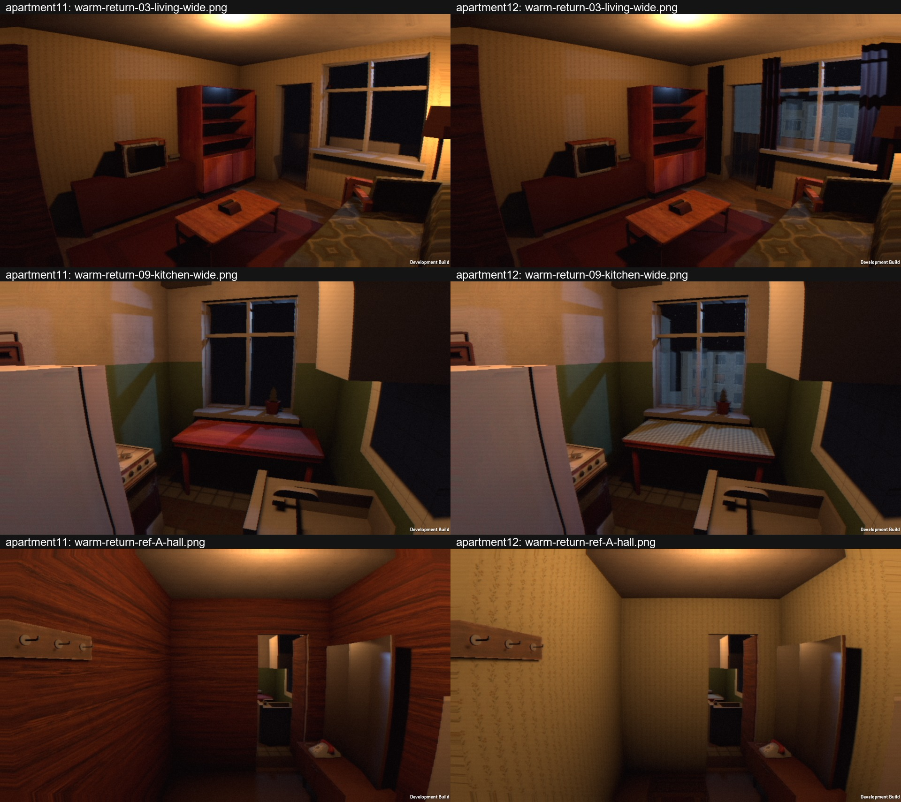

Ограничения и следующий крупный шаг: docs/reviews/2026-10-12/apartment12/README.md. Сборка builds/Ataka-apartment12-win64.zip; Apartment11 сохранён.

## 12.10 — прямое поручение Димы: Claude пишет код
Приоритет изменён: быстрее довести ядро до играбельного состояния, полировку деталей отложить. Claude теперь не только ревьюер: ему поручены самостоятельные правки актуального кода в отдельной ветке от checkpoint Apartment12. Codex не меняет параллельно те же файлы; принимает коммиты, собирает Windows, проходит маршрут и возвращает реальные скриншоты/ошибки. Успешный автотест не означает принятую играбельность. Свет/VHS сохранять, новых сюжетов не придумывать.

## 12.10 — Claude пишет полную игру; первый патч проверен
Интегрирован патч 9424136: триггер балкона с маршрута, связанная рука, подсказки. EditMode85/85, Windows build, D3D11 полный маршрут 52PASS/errors0/coreFinished. Оригиналы: docs/reviews/2026-10-12/claude12-windows. Просмотрены балкон1.1 и смерть1.1: смерть всё ещё неприемлемый манекен. Тест относится только к ядру, не ко всей истории. Меню вручную/человеческое прохождение/прослушивание не проверены.
Дима поручил довести целую игру до финала и исправить модель/когти/смерть. Передано Claude для реализации отдельной веткой от9424136; мелкая полировка отложена, текущий свет/VHS сохранять.

## 12.10 — подготовка готовой кухни и работа Claude над историей
Проверены в Blender оригиналы SovietSink и WoodenWallCabinet, приведены к единому метровому масштабу, подготовлены FBX/текстура. Раковина без авторских изображений, материалы/установка ещё впереди. Отчёт docs/reviews/2026-10-12/kitchen13-prepared. Claude активно пишет FaceTearDeath, GuestVisual/Installer и StoryDirector; нового патча ещё не получено. Загрузка выбранных моделей Гостьи/кисти блокируется Chrome; Дима сейчас не может скачать вручную. Реализацию остальной игры продолжаем, манекен не считать заменённым.

Кухня13 установлена отдельно: две готовые модели, правильные метрические размеры, принятые light/VHS неизменны; Windows build exit0,50кадров обзора. Просмотрены3ракурса кухни, форма и ориентация правильные. Проходимость/полная история этим обзором не подтверждалась; кадры в docs/reviews/2026-10-12/kitchen13-prepared.

## 2026-10-12 — Story14, сюжетные проверки Windows

Интегрированы патчи Claude 01–07. На сборке 01–04 + исправления Codex прошли вечер/две ночи до петли, отдельный финал и старое ядро (6 кругов/погоня), без runtime-ошибок. Это ускоренная постановочная проверка сюжета, не ручное прохождение целиком. Защищено обычное сохранение от удаления в QA; обход парных действий не меняет перечисляемую коллекцию. Готовые Гостья/когти не получены, Дима пока не может скачать; ищем альтернативы, не выдаём прокси за результат.

Кадры и границы проверки: [Story14](docs/reviews/2026-10-12/story14-windows/README.md).

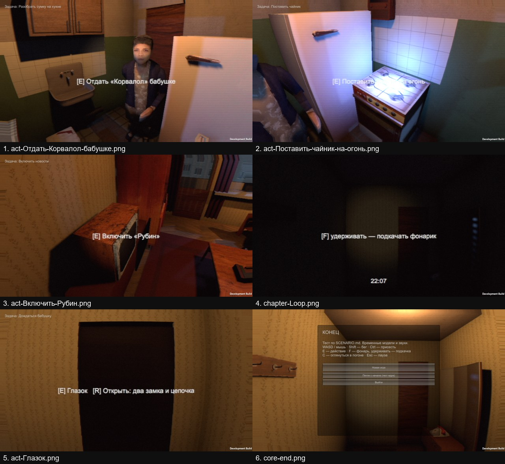

После pc08 сборка успешна, но QA **FAIL**: пять участков маршрута бабушки пересекают коллайдеры. Финал через FinishCore и отдельное сохранение/Continue работают; общая проходимость не принята. Подробности и логи в Story14. Claude получил P0 на маршруты, ожидается исправление.

## 2026-10-12 — Story15: household bank, real route failures

- Claude pc09 guest-source importer, pc10 household recordings, pc11 capsule-grid grandmother routes.
- TV interaction now aims at `televisionScreen.bounds.center` instead of the hidden/edge logical pivot. Kept when merging pc10.
- ScenarioAudioBuilder installed the new bank in the existing scene; no scene regeneration or lighting migration.

## Actual results
- story15-build-b: Windows build exit 0, Unity 6000.3.26f1.
- story15-edit-b: 85/85 EditMode tests passed, including household cue presence/mono checks.
- Audio file audit: 17 prepared WAV hashes match the manifest, mono, zero clipped PCM samples. Listening pending. Radio uses the existing temporary original waltz.
- story15-flow-b (older build): failed TV aim.
- story15-flow-a (TV fix): TV action succeeded (image below). After this no next objective appeared for over eight minutes; terminated ONLY this QA process and recorded interrupted.json. No passing flow result; suspected player/grandmother obstruction still needs diagnostics.
- story15-flow-c (pc11 + bank): 0 runtime errors, FAIL, routeFailures=3. Living-room walks now have paths; Door→Kitchen, Kitchen→HallA and Door→Stove have no route. Runtime capsule matches test r=.22/h=1.5.
- Runtime logs also report GRAN_ROUTE_FAIL Door→Kitchen. She stays in the hall (image below).
- Next action fails: matches on fridge, target (8.24,1.58,2.43), eyes (8.14,1.57,3.24). Autopilot stages camera outside kitchen, so wall/door LOS must be diagnosed; do not weaken LOS to pass.

## Next corrections
1. Resolve kitchen throat: dresser and kitchen south wall/leaf; actual world bounds are in checks.txt and sibling story15-spatial.
2. Improve QA positioning/diagnostics and yield to grandmother so a staged test cannot deadlock itself.
3. Continue real Windows flow and the two death branches after fixes. Current result is NOT release-ready.

Evidence and game screenshots: [Story15 Windows](docs/reviews/2026-10-12/story15-windows/README.md).

## 2026-10-12 — Story15, pc12–14: kitchen routes and authored Guest candidate

## Update: pc12–14 and candidate Guest installed
- pc12: all nine actual Unity route checks PASS (including opened kitchen/entrance leaves). Furniture collisions preserved.
- pc13: authored OGA CC0 creature and right forearm installed in the real scene; Unity recognizes Idle/Jump/Run/Walk. Normal map imported as NormalMap; GuestVisual safely handles early enable. This is a CANDIDATE: male torso, short fingers, no grandmother face and no crawl animation. It does not satisfy the requested final Guest/long black claws. Claude explicitly received that rejection of final-art status.
- pc13 flow-e: routes 0 failures, runtime 0 errors. QA yielded the narrow TV passage and grandmother reached Landing and left. Whole result FAIL because the old one-direction Approach aimed at the lock from behind the jamb.
- pc14 flow-f: routes 0 failures, runtime 0 errors. Adaptive Approach exposed a race at the balcony: sampled the jar before the leaf opened, then the same jar became aimed during the FAILED screenshot. Result FAIL, not player-path acceptance.
- Local follow-up waits .65 game seconds before sampling QA approach; no runtime LOS, furniture or door safety logic changed. Compiled in story15-build-g. story15-flow-g is the next run; its result is not yet claimed here.
- StoryRuntimeProbe only activates with -story-smoke. It records live positions/state and actual timed DeathFull/DeathShort screenshots; never moves actors or changes story state.
- Sources/credits: [author's OGA CC0 release](https://opengameart.org/content/3d-horror-game-monster), CREDITS-GUEST.md. Author page independently checked. 17 WAV numeric audit and 85 EditMode passes above remain limited evidence, not listening/art/gameplay acceptance.

The accepted LightLab lighting/VHS and architecture were not regenerated. No new release ZIP is presented as ready. Still required: complete uninterrupted flow, negative branches, actual death-frame review, authored long claws, story props, voices and human playability/visual acceptance.

## 12.10 — Story16: предметы и реальный проход до петли
Интегрированы pc15/16: готовые чайник, спички, хлеб, ремень, сервиз; сетка проходимости расширена до балкона с проверкой опоры. Windows story16-flow-a прошёл вечер и обе ночи до Loop: errors=0, routeFailures=0. Это постановочный автопилот, не человеческая приёмка. 85/85 EditMode. Кадры и отчёты: docs/reviews/2026-10-12/story16-windows. pc17 (когти из авторской кисти) принят в исходники, ещё не установлен; старые кадры смерти отвергнуты по реальному виду и переданы Claude. Подготовлена существующая CC0-лампочка (11 см), ещё не установлена. Цель активна, игру завершённой не считать.

## 12.10 — Story18: готовые когти и реальная постановка смерти
Интегрированы pc17/18, новые материалы и измеренная ориентация кисти, установлен готовый Story/Bulb. Два Windows-прогона death-qa: полная/короткая смерть в прихожей и зале, с фонарём/без; 88/88 кадров, errors0. Исправлены пересвет и невидимые руки, но тело смотрит боком и видны срезы предплечий. Художественная приёмка НЕ пройдена. Реальные кадры опубликованы docs/reviews/2026-10-12/story18-death, переданы Claude; он также готовит JamJar/Shawl/Cans из прямых источников. Новую цель завершённой не объявлять.

## 12.10 — Story20/21: реквизит и проверка реальной смерти
Установлены все 11 готовых сюжетных предметов. Story20-flow-b: вечер и две ночи до Loop, errors=0, routeFailures=0; автопилот ставит игрока у действий, поэтому ручную проходимость этим не подтверждаем. Исправлен регресс pc20: комментарий отключал назначение готовых кистей; тест теперь отклоняет отсутствие clawSource. Настоящий кадр первой смерти всё ещё показывает туловище вместо лица, в отличие от отдельного теста при pitch=0. Передано Claude, опубликовано docs/reviews/2026-10-12/story20-flow. pc21 исправляет ось лица через bind pose и ставит готовую антресоль; собирается. Финальный арт/голос не приняты. Беззвучная QA сохраняется. Цель активна.

## 12.10 — Story23: проверенная смерть, двери, сквозная тестовая сборка
Интегрированы pc19–23 и локальный фикс GuestVisual: после ползания восстанавливается исходное положение готового тела. Смерть больше не наклоняет корпус по взгляду игрока и возвращает камеру к постановке за 0.18 с. Story22-death-b: 145/145 реальных PNG, pitch 0/+60/-60, два помещения, полная/короткая смерть и настоящая последовательность ночи 1; голова готовой модели проверяется в viewport. Claude открыл пять кадров и признал постановку пригодной только для первого preview. Финальный арт не принят.
Story23-doors-a: 12 PASS; продолженный вечер открывает кухню/спальню, переход в Loop закрывает/запирает кухню и ванную. Обычное меню скрывает тестовые кнопки без -qa. Story23-flow-a: вечер+две ночи до Loop PASS/errors0/routes0, лампочка на готовой антресоли доступна. Идёт заключительная проверка ядра и финала перед отдельным Windows ZIP. Полный список существенных пробелов: docs/reviews/2026-10-12/claude-playable-complete/PREVIEW-NOT-IMPLEMENTED.md (двор/подъезд, свободное время, видео ТВ, настоящая перемотка, формы/анимации Гостьи, этапы финала, голоса). Цель остаётся АКТИВНОЙ. Следующий приоритет — эти пробелы, не микрополировка.

12.10 Story23: заключительные Windows core-a и finale-a PASS (errors0), шесть кругов/погоня/переход к финалу проверены отдельными прогонами. Подготовлен отдельный preview-архив; готовность всей игры НЕ заявляется. Отчёт docs/reviews/2026-10-12/story23-windows/README.md.

12.10 — Story23 выдана отдельным локальным ZIP builds/Ataka-story23-preview-win64.zip (149129994 байт; SHA256 5fce4236f69d2e0ff677ce46934090db37416d90ed4ea207e815e0894626fd11). Распакована playable/Story23, проверены SHA всех288файлов. Эта копия не меняется дальнейшими сборками. Цель не завершена; ручная и звуковая приёмка впереди.

## 12.10 — Story24: настоящая перемотка, первая проверка отклонена
Интегрирован pc24 и усиленная QA (SHA патча aa33c01f…); Windows build-b собран. Реальная ночь записана, затем проиграна назад: 2598 состояний, 52 звука, 9.610 с активного времени, пауза 0.516 с без сдвига часов, нарушений обратной хронологии 0, ошибок runtime 0. Четыре воспоминания в этом отдельном тесте ПОСТАВОЧНЫЕ, не подтверждают проход настоящего вечера.
Визуально не принято: PLAY упирается в затылок бабушки; кадр чая смотрит в холодильник; часть ночи почти чёрная; поверх остаётся старое задание. One light FAIL требует правильной исходной точки и имени лампы (проверка стартовала внутри смерти с отключённым фонарём). Silent capture выявил повторные запуски ticking на паузе; звуки пользователю не воспроизводились. Численные peak0.476/dropped0 не означают художественной приёмки.
Claude получил оригинальные PNG/контакт-лист и код в Codex=84d1fca. Готовит pc24b: постановка, реальное сохранение воспоминаний, пауза/HUD, ограничение аудиокэша и запись настоящего прохода вечера. Доказательства: docs/reviews/2026-10-12/story24-rewind-rejected. Выданная playable/Story23 и ZIP неизменны. Цель активна, полный объём SCENARIO остаётся, игра не объявлена готовой.

### Story24 pc24b — промежуточный результат
pc24b SHA25d05e03… интегрирован (841b65e). Unity story24-build-c exit0; Windows story24-rewind-c: все проверки PASS, errors0, 9.606с, save/Continue4/4, свет не переключается, обратная хронология без нарушений, кэш5.98MB освобождён. PNG подтверждают исправление PLAY (камера вне бабушки), чай/варенье и доступность меню паузы. Ремень в воспоминании почти чёрный — художественно не принят, несмотря на Visible=true. Доказательства docs/reviews/2026-10-12/story24-rewind-c опубликованы Codex=2a7902d.
Запущен story24-flow-c от Prologue (WindowsPID21612, exec-session18873) для проверки настоящих вечерних воспоминаний; итог ещё НЕ получен. Claude делает отдельное дополнение к pc24b: прекращение побочных звуков на паузе и запись высоты камеры при приседании; ему также передан тёмный ремень. pc24b не переписывать и не скачивать повторно под другим хэшем. Новый пакет сначала проверить по SHA/диффу, собрать, пройти. Windows test source сейчас соответствует pc24b. Story23 не изменена, цель активна.

### Story24 pc24c — пауза и приседание проверены
Реальный flow-c завершён: Prologue→Evening→Night1→перемотка→Night2→Loop, errors0/routes0,4 настоящих воспоминания. Доказательства story24-real-evening. pc24c fedaa629… применён (8a2d234), build-d exit0, rewind-d PASS: на паузе0 новых cues/requests; тик1started/0limited; высота камеры945crouched/1560standing записей,0 mismatches; PLAY1.55м, отмена возвращает0.94м.9.606с. Звуки не прослушивались,8 из55reverse-oneshots ограничены бюджетом перекрытий. Доказательства docs/reviews/2026-10-12/story24-rewind-d. Все процессы этой проверки завершены.
Открыто: тёмный ремень (и поворот головы knock) в памяти; Claude получил pc24d на1dc7a5f. У него активный чат, требуется получить отдельныйпатч. Смерть присев в этом QA реально выполняется, но её крупные планы не сняты — нужны3–4 кадра в следующем прогоне. Следом содержательная постановка финала по NEXT-PACKAGES. Story23 неизменна, полная игра не завершена, цель АКТИВНА.

### Story24 — исправлена поза бабушки в воспоминаниях
pc24d (9a00156) дал читаемый ремень, но Windows rewind-e честно завершился FAIL: тёмный knock и поза повешения в воспоминании вечера. Причина найдена в данных Memory: сохранялся root, а кости оставались от ночи. Теперь сохраняются 25 локальных трансформов рига; для старых сохранений и отдельно тестовых воспоминаний используется существующий idle. Камера вычисляется после восстановления позы, небольшой fill действует только внутри воспоминания. Общий свет не менялся.
Build-f поймал конфликт имени переменной в новом QA; исправлен. Build-g и rewind-g exit0, errors0, все проверки PASS: pose roundtrip2/2, memories4/4, ошибка позы0°, facing0.999, darkFrames0, пауза0 новых cues, присед0 ошибок, длительность9.612с. PNG просмотрены: голова ровная, лицо смотрит в кадр; ремень и чай читаются. Доказательства e/g сохранены в docs/reviews/2026-10-12/. Смерть из приседа снята: монстр и когти в кадре, но поздняя красная плоская маска остаётся арт-заглушкой.
Сейчас запущен story24-flow-g от Prologue для реальных вечерних воспоминаний. Его итог пока не получен. Claude параллельно пишет pc25 (финальная встреча, две ветки входа, кухня, трансформация и короткая смерть); интеграции pc25 ещё нет. Story23 не затронут, цель активна, финальная игра не завершена.

### Story24 — проверен настоящий вечер после исправления лампы
Flow-g выявил ещё один дефект: Remember(bulb) выполнялся перед включением нового бра. Исправлен порядок (56c5623), не яркость общего света. Build-h/flow-h exit0: настоящий вечер → Night1 → 4 реальных воспоминания/PLAY → Night2 → Loop1; errors0, routeFailures0. PNG новой лампы просмотрен, свет включён. Проверка автоматическая с ускоренными ожиданиями/вызовами действий, не ручной проход. Доказательства: docs/reviews/2026-10-12/story24-real-evening-h; неудачный flow-g тоже сохранён. Сохранённый Story23 не менялся.
pc25 SHA11a30861… применён коммитом0cba2df. Локально исправлен преждевременный выход FinaleQA при начале Ended (должен ждать loop.Finished) и ожидание StoryAutopilot на DeathFinale. Добавлен тихий runner rendered_finale.py. Начата сборка story25-build-a. Финал ещё не проверен в Windows; отсутствующая лицевая геометрия, голоса и альбом остаются в объёме. Цель активна.

### Story25 — две ветки дошли до эпилога, арт-проверки провалены
Build-a (pc25 + локальное исправление ожидания конца эпилога) собран. Реальные Windows open-a/key-a дошли до меню КОНЕЦ, errors0, все цели рук чайника/спичек достижимы, 11.9 и DeathFinale по3.5с, refused-карточка только в key. Обе проверки FAIL: верх модели4.51м при потолке2.5м; open также камера объятия0.47м от плеча. PNG лично просмотрены: геометрия кистей уходит в потолок, слишком крупное лицо в объятии, в key цепочка плохо читается. Это НЕ принятый финал. Все кадры: docs/reviews/2026-10-12/story25-open-a и story25-key-a.
Локальная попытка исправления в build-b: кончики кистей/оси растяжения берутся из вершин готового меша в bind-space, длина учитывает масштабы предков; камера плавно наклоняется к левому плечу. Build-b скомпилирован, сейчас open-b проверяет результат. Коррекция ещё НЕ признана успешной. Story23 неизменна; мелкая полировка не заменяет отсутствующие лицо, голоса, альбом. Цель активна.

### Story25 — независимый замер подтвердил рост2.396м
В build-c устранено накопление IK, но выявлено чтение костей в момент сброса до LateUpdate. В d GranReach ждёт EndOfFrame перед привязкой предметов: reach снова все PASS; руки в конце превращения направлены к игроку полным IK-весом1. В e независимое преобразование ВСЕХ вершин bone.localToWorld×bindpose и BakeMesh(true)+TransformPoint совпали:2.396м. Старый BakeMesh(false)+TransformPoint давал3.189м из-за повторного масштаба. Порог роста не менялся. Эта часть прежних FAIL относится к измерителю; исходные вылетавшие кисти были настоящим видимым дефектом.
Key-e exit1/errors0: остался запрос позиции кисти до LateUpdate, в то время как завершённый reach попадал в цель. Добавлен cache последнего отрисованного fingertip в actor-local и порядок DoorChain600 после GranRig500. Это ещё проверяется. Claude открыл реальные кадры и выдал pc25b SHA5edbefd4… (цепочка/свет площадки/кадр руки/мягкая тень), рост не тронут. Далее интеграция и обе ветки. Story23 нетронут, цель активна.

### Story25 F — обе ветки проходят, исправлен момент проверки позы
Windows key-f/open-f exit0, ошибки0, полный эпилог, порядок событий и обе развилки PASS. pc25b сделал цепочку видимой и поднял коготь перед лицом; жёсткая левая плашка заменена мягким затенением только в DeathFinale. Исходные кадры сохранены в story25-key-f/open-f. Просмотрены пальцы1.0, объятие1.5, превращение3.4, смерть2.7. Арт НЕ принят: кисть целиком растягивается как брусок, объятие очень крупное/тёмное, Гостья мужская временная; лицевой геометрии/срывания лица нет.
Claude при проверке кода заметил: MeasureTop и TRANSFORM читали позу ДО LateUpdate. Предыдущее число2.396м корректно для той позы, но ещё не доказывает потолок в отрисованной позе. Исправлено: замер в EndOfFrame, QA после Shot, камера читает cached rendered HeadPosition. Рост/пороги не менялись. Build-g exit0; key-g в процессе, окончательного результата пока нет. Story23 сохранён, цель активна; pc26 ещё не интегрирован.

### Story25 G — замер отрисованной позы подтверждён
Key-g/open-g PASS, errors0, обе концовки до меню. Измерение после EndOfFrame: примерно2.503м, CPU и BakeMesh(true) совпадают; голова в кадре. Ранее2.396м относилось к позе до процедурного слоя. Пороги не менялись. Кадры и результаты story25-key-g/open-g. Арт-ограничения F остаются; Claude делает отдельную замену кисти на готовую когтистую модель и проверяет объятие. Далее pc26: изображение на реальном CRT и четыре вечерних события. Цель активна, Story23 неизменна.

### Story26 B — готовая кисть, вечер и ТВ
Интегрированы pc25c (c5d1942c), pc26b (43a7770a). Build-b exit0; key-b/open-b PASS до эпилога, errors0. Коготь снимает цепь, обе старые кисти схлопнуты; руки11.9 перенесены перед камерой на уровень груди. Исходные кадры обнаружили перекрытое объятие и ладонь внутри головы в конце смерти. Объятие исправляется36e8aea (камера наружу/взгляд мимо плеча); Claude выдал pc25d b22d25c1 для ладони.
Evening-b PASS/errors0: восстановление Guest после прерывания зеркала и её видимость в следующей DeathShort, четыре события, новости, два эфира, корректное завершение. В A тест ждал12с при репликах4×3.2+1; timeout30 и EndOfFrame исправили только QA, не темп игры. A finalJSON повреждены NUL после перезапуска окружения, не используются как доказательство. B сохранены валидные JSON/PNG.
Зеркальная фигура в B не читается. pc26c dac38912 принят в код: отдельное отражение и сравнение пикселей до/после, пока не проверено. Добавлено освобождение отражения OnDisable/OnDestroy. Следующая сборка C проверит зеркало/объятие/ладонь. Story23 не менялся, цель активна, лица/голоса/альбом и остальной SCENARIO остаются в объёме.

### Story26 C — зеркало видно, объятие ещё не принято
Evening-c PASS/errors0: реальный силуэт в зеркале (6.0% RT,5.5% кадра), cleanup, четыре события и оба ночных эфира. Open-c PASS/errors0 до эпилога; просмотр PNG выявил всё ещё перекрытый кадр объятия1.5 — НЕ исправлено. Коготь в2.7 теперь перед лицом. Оригиналы docs/reviews/2026-10-12/story26-evening-c и story26-open-c. Идёт story26-flow-c от Prologue. Claude начал pc27 Dendy/эпилог/совместимость CRT с перемоткой; для альбома генерируем вымышленные фото. Story23 сохранён, цель активна; полной готовности и художественной приёмки нет.

### Story27 A — содержимое вечера и эпилог
Pc27 SHA96e0f14e интегрирован. Семь вымышленных фото image_gen подключены в Resources/Album, промпты сохранены. Исправлены до запуска: аллокация NightRewind в комментарии, короткая строка спрайта, открытие/закрытие газеты одним E. Build-a exit0. Epilogue-a и open-a PASS/errors0; финальное фото загружено. В объятии теперь видна прихожая: камера с внутреннего плеча, доказательство PNG, headmesh coverage0%; прежний тёмный кадр был направлен в дверь. Leisure-a FAIL до запуска — тест подошёл к ТВ из-за стены; новый QA использует проверенную точку в зале и явно проверяет Aimed/LOS. Длинные субтитры эпилога обрезались, исправлен safe-area/wrap; нужен build-b. Rewind-a проверяет новую запись show/caption. Предыдущий flow-c PASS Prologue→Loop/errors0. Story23 неизменён. Голоса/лица/полный пролог и ручная приёмка остаются, цель активна.

### Story27 D — сохранён кандидат для отдельного теста
Build-d exit0 (runtime source35a75a3). Leisure-d PASS/errors0: все3 занятия реально выбираются через Aimed/LOS, 6 фото, score1200/kills12/shots43; обе паузы0drift, FOV34→65. Epilogue-d (refused) PASS/errors0:4 новости, финальное фото, ticking/cleanup; длинные субтитры помещаются. Flow-d PASS: Prologue→Evening→Night1→реальная перемотка→Night2→Loop/errors0/routes0. Core-d PASS:6 кругов, проход дверей, повторная смерть/пропуск, пауза, часы42–50с, завершение ядра. Это отдельные автоматические проходы с QA-помощью; не непрерывная ручная игра. Звук capture→mute, слуховой приёмки нет.
Телевизор: старый экран-коробка от Kenney заменён точно2 треугольниками готового SovietTV, скопированными из UV-острова стекла с отступом1мм; исходная модель/текстура/свет не менялись. PNG console-2-play и epilogue-news-1 подтверждают размещение внутри рамки. Leisure-c сохранён как FAIL: цвет измерялся после уничтожения11/12 врагов. В D замер до стрельбы, порог прежний, цвет1.0%. Rewind-a PASS:4 реплики в обратном порядке,11/11 синих кадров,9.603с,0dark/0poseerror; исходники результатов сохранены.
Просмотрены оригиналы: console/epilogue D, flow D чай/приставка/переход Loop, core D меню/поворот/часы. Качество FtF и завершённость арта не заявляются. Оригинальные доказательства: docs/reviews/2026-10-12/story27-*. Story23 неизменна. Pc28 b1caf45c и pc28b428bc037 скачаны, ещё НЕ применены: превью27 без трансформации лица. Остаются полный3Dпролог, лица, одобренные голоса, временные модели и человеческая приёмка. Цель активна.

### Story27 выдана; pc28 после Windows-проверки НЕ принят
Сохранены playable/Story27/Ataka-Loop.exe и builds/Ataka-story27-preview-win64.zip (155952337 байт, SHA256 ad0add9c9f48f5f9ac53e1df518d7b909e443a03fdeac98a689b433fcf3880de). Все288 runtime-файлов копии сверены с манифестом. SHA архива Story23 прежний5fce4236… Цель активна; Story27 промежуточная, ограничения в docs/STORY27-PREVIEW-RU.md.
Pc28/28b применены (e3dee42/6723d7d). Installer создал лицо из готового Quaternius Adult — явно временная замена, НЕ лицо12-летнего Миши. Исправлены: выбор Guest-renderer по headBone вместо скрытого старого Eyebrows; Read/Write у GuestBody; не показывать частично созданные детали до Ready; проверка полного съезда глаза на1.35 после конца1.3; первые2 wristY подняты, чтобы маска была видна.
Build-C exit0. Face-C errors0/events PASS, НО его passed=true НЕ означает приёмку: QA только печатает рост3.98м, не проверяет; отдельная staging-поза начинается с top.898/bone(.71y) вместо нормального idle. Полная key-C до эпилога/errors0, FAIL рост2.557 при потолке2.5 и пороге2.52. Нормальный start top1.5546/grow1.5438; значит отдельный QA-start и настоящая геометрия — разные дефекты. PNG1.2/2.8 просмотрены: чужая голова вылезает сверху, лицо тёмное/неправильный срез, плавает над шеей. Никакого визуального PASS. Кадры/JSON A/B/C иkeyC опубликованы Codex350808b.
Claude делает pc29 (пролог) и получил в очередь приоритетное ревью28c: проверить реальную геометрию/рамку/UV/нормали, исправить QA-staging/рост, не подгонять пороги. Патч28c пока не получен. Перед следующим запуском читать ответ в авторизованном чате; сохранённые Story23/27 не трогать.
Для пролога самостоятельно получены Quaternius Animal Pack2 ZIP (CRCOK, Dog.fbx/blend) и CC0 small dog behind door s3537; исходники/источники/хэши в art-source/prologue, ещё не импортированы/не прослушаны. Большой Katcho Free_Character.zip через itch UI пока не появился на диске, после обычного и предложенного сайтом alternateCDN. Открыть chrome://downloads автоматическая политика запретила; обход не выполнялся, пользовательский вход/скачивание не требуются для продолжения.

### Story28 G — исправлена причина перекоса QA; лицевая сцена всё ещё отклонена
pc28c SHA57f7e244 применён c0e5f2e. Full key-D errors0, эпилог достигнут, FAIL grownTop2.52367>2.52. Оригиналы1.2/2.8 показали чёрную маску и разрыв между головой и шеей — арт НЕ принят. Claude получил ветку Codex a7bf55d с кадрами/JSON D и делает pc28d; не считать Blender-проверку подтверждением Unity.
Face-D/E/F: staging top.897, grow3.930. Idle reset/прямой SampleAnimation/AlwaysAnimate НЕ помогли. Editor-аудит исходных костей показал исправный idle. Настоящая причина найдена: QaFaceRun вращал ВСЁ тело LookRotation(StoveAt-Stand), вектор включает высоту конфорки. Исправлено горизонтальным ProjectOnPlane, culling-эксперимент убран. G подтвердил faceBase1.555, errors0, рост2.527 (FAIL, порог неизменён). Кадр face-2.30 по-прежнему с разрывом головы. Только постановка QA исправлена; готовности лицевой сцены нет.
Получен pc29b-prologue.patch SHA b5066400585d31b6f4b1da72d5cb61d33065aeab2672e9d400f76b3d1f5754f1 в Downloads, ещё НЕ применён и полностью не прочитан. Claude исправил40м, полное восстановление Guest, Night2соседи, ступени-пандусы и настоящуюQAходьбу. apply-check конфликт только FaceQA: у нас возраст15 уже исправлен. --exclude=unity-game/Assets/_Project/Scripts/Scenario/FaceQA.cs проходит; перед применением прочесть полный код. Следующий приоритет — собрать и пройти 3Dпролог.
Подготовлен Resources/Audio/dog_bark.wav:1.35с из CC0 BigSoundBank3537, mono48k/16bit, fades15/180ms, peak-9.89dBFS. Источник+SHA+точный монтаж в art-source/prologue/dog-bark-edit.json, воспроизводимый скрипт tools/audio/prepare_prologue_bark.py. НЕ прослушан, пока не подключён в работающем прологе. QuaterniusDog исходники и инспекция:нетUV/текстуры,303verts602tris,Idle/Walk. Не импортировать как финальную рыжую дворнягу.
Story23/27 неизменны. Рабочий билд ScenarioCore — story28-build-g, НЕ кандидат для выдачи. Цель активна, звуковой вывод QA заглушён. Нет живыхUnity/плееров послеG. Claudeчат сохранён; ему в очереди уточнение причиныQAнаклона, он работает над pc28d.

### Story29 C — настоящий пролог прошёл маршрут
Интегрирован полный pc29b SHA b5066400585d31b6f4b1da72d5cb61d33065aeab2672e9d400f76b3d1f5754f1. FaceQA возраст15 уже исправлен, повторный хунк пропущен; остальные изменения прочитаны и применены. Добавлены InstallAndBuild и tools/qa/rendered_prologue.py. Новая геометрия — существующий M1-модуль лестницы и материалы, двор40м,5этажей,9маршей. ПринятыеLight/VHS installer сравнил без изменения. Модели Вали/Тузика, замок люка, смех ТВ, фотообъявление отсутствуют, не скрыты заPASS.
A exit1/errors0: двор, вход, все9маршей, пар, крыша, объявление прошли; вход в квартиру застрял (8.51,.01,7.40). Наружная дверь тамбура открывалась на стоящего посетителя, её полотно перекрывало кадр. C: direction=-1 только у outerdoor (створка внутрьтамбура), общий ScenarioDoor/capsule safety не менялся. QA дополнен реальным углом>70°, записьюCueStarted dog_bark, отдельной процессной клавиатурой/мышью и кадрами/коллайдерами приFAIL до диагностическогоPlace. B был промежуточной сборкой без исправления двери (скрипт остановился на UTF-8-чтении); B не использован как доказательство.
BuildC exit0; prologueC exit0/PASS/errors0/stuckLegs0: пройдено77.10м суммарныхотрезков отгаражейдо квартиры, настоящимCharacterController;13скриншотов, события3.1–3.9 и4.9/8.1cleanup. Проверены40мдвор,9маршей, aiming/LOS всехдействий, пар2/3выдоха, вспышкилампы, Guestrestore, фактическийлай, открытиедверей и отключениепрологапослевхода. PNG бабушкаоткрывает C просмотрен: теперь видны лицо/тёплаяприхожая/полнаяреплика. Это автоматическийпроход, не живойчеловеческийтест и не художественнаяприёмка. Вдали двора видна грубаясветлаягоризонтальнаяполоса; отделкалестницыпокапростая. Голосаещёнеприняты.
Доказательства A/C: docs/reviews/2026-10-12/story29-prologue-*. Запущен story29-flow-c --chapterEvening длярегрессиивечер→ночи→Loop, результатещёнеизвестен. Story23/27 неизменны; SceneCore workbuild29C пока невыдан. Claude занят pc28d (лицо), вочередиуточнениепричиныQAнаклона. Цельактивна.

### Story28 H / Story29 flow C — две независимые проверки
Story29-flow-c завершён exit0/PASS, errors0/routeFailures0: Evening → Night1 → смерть → обратная запись четырёх реальных воспоминаний → Night2 → Loop. Это автоматическая проверка с постановкой камеры и ускорением ночных ожиданий; не ручное прохождение и не приёмка арта.
Применён pc28d-face-attach-bf3a17c.patch, SHA256 016fa9d5f7395c85fd335b882cc129492ae4cfebd5f582bc9d5162d8a5394b74; прочитаны все C# изменения, apply-check чистый. BuildH exit0. FaceH exit1/errors0: рост2.52725 всё ещё превышает2.52. Шов0.000001м и darkShare19.7% дали PASS, но ОРИГИНАЛЫ PNG1.20/2.30 по-прежнему показывают тёмную маску и голову над пустотой. Эти метрики не доказывают визуальную целостность! Арт снова отклонён, требуется проверить поверхность/нормали/видимую шею, а не только совпадение исходных вершин. Полная key-H проверка запущена.
Скачано публичное CC0-превью small audience laughter (Freesound17121), источник/хэш в art-source/prologue. Ещё не подготовлено и не встроено. Story23/27 сохранены, цель активна.

### Story28 key-I / Story29 D — финал и запись ТВ
key-H был остановлен после исключения при синхронном сохранении PNG: имя `01-22:00.png` содержит запрещённое в Windows двоеточие. FinaleQA теперь заменяет Path.GetInvalidFileNameChars перед записью. Это исправление диагностики, не игрового сценария. Build story29-build-d exit0. key-I дошёл до эпилога, errors0, 23 события по порядку, превращение3.5215с, DeathFinale3.491с. Единственный автоматический FAIL: рост2.52381>2.52; порог не менялся. Оригиналы 1.2/2.8 просмотрены: лицо остаётся почти чёрным; полный кадр2.8 показывает шею, но образ по-прежнему неприемлем. FaceH и keyI нужны вместе, разные углы выявляют разные проблемы.
Добавлена tv_laughter.wav, CC0 Freesound17121 public HQ preview, 3.445с, mono44.1k/16bit, фильтры180/2800Hz, peak-6dBFS, конечныефейды. Источник, лицензия и монтаж записаны в CREDITS-AUDIO и art-source/prologue; инструментарий воспроизводимый. Слуховой приёмки нет. PrologueQA теперь проверяет реальный CueStarted tv_laughter после смены канала, а не наличие файла. Запущен story29-prologue-d с настоящей ходьбой.
