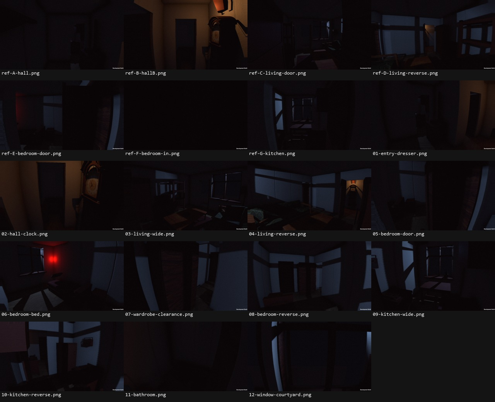
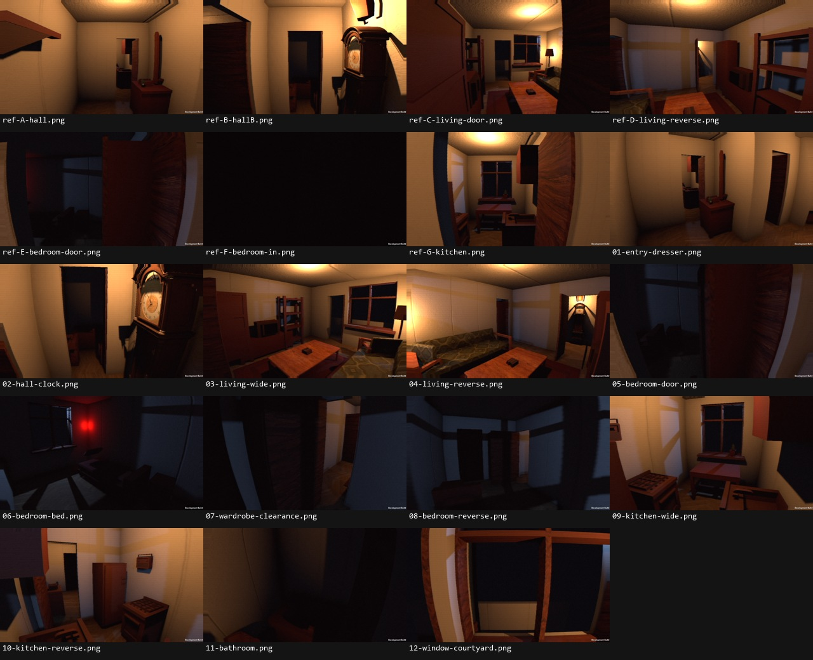

# Полный обзор текущей квартиры

38 исходных кадров 1280×720 из Windows-билда. Две таблицы ниже — только навигация; для оценки деталей открывать оригиналы. Пользователь отверг художественный результат. Это материал для ревью, не принятый арт.

QA-условия: камеры установлены инструментом; внутренние двери открыты, события отключены, фонарик выключен. Свет: существующие lap1 и warm-return. Никакой новой подсветки или обработки исходных кадров. ref-A…G: позиции/углы Claude для v3, FOV68; остальные FOV65. Все координаты в survey.json. Эта съёмка не подтверждает проходимость.

## lap1

- [lap1-ref-A-hall.png](lap1-ref-A-hall.png)
- [lap1-ref-B-hallB.png](lap1-ref-B-hallB.png)
- [lap1-ref-C-living-door.png](lap1-ref-C-living-door.png)
- [lap1-ref-D-living-reverse.png](lap1-ref-D-living-reverse.png)
- [lap1-ref-E-bedroom-door.png](lap1-ref-E-bedroom-door.png)
- [lap1-ref-F-bedroom-in.png](lap1-ref-F-bedroom-in.png)
- [lap1-ref-G-kitchen.png](lap1-ref-G-kitchen.png)
- [lap1-01-entry-dresser.png](lap1-01-entry-dresser.png)
- [lap1-02-hall-clock.png](lap1-02-hall-clock.png)
- [lap1-03-living-wide.png](lap1-03-living-wide.png)
- [lap1-04-living-reverse.png](lap1-04-living-reverse.png)
- [lap1-05-bedroom-door.png](lap1-05-bedroom-door.png)
- [lap1-06-bedroom-bed.png](lap1-06-bedroom-bed.png)
- [lap1-07-wardrobe-clearance.png](lap1-07-wardrobe-clearance.png)
- [lap1-08-bedroom-reverse.png](lap1-08-bedroom-reverse.png)
- [lap1-09-kitchen-wide.png](lap1-09-kitchen-wide.png)
- [lap1-10-kitchen-reverse.png](lap1-10-kitchen-reverse.png)
- [lap1-11-bathroom.png](lap1-11-bathroom.png)
- [lap1-12-window-courtyard.png](lap1-12-window-courtyard.png)

## warm-return

- [warm-return-ref-A-hall.png](warm-return-ref-A-hall.png)
- [warm-return-ref-B-hallB.png](warm-return-ref-B-hallB.png)
- [warm-return-ref-C-living-door.png](warm-return-ref-C-living-door.png)
- [warm-return-ref-D-living-reverse.png](warm-return-ref-D-living-reverse.png)
- [warm-return-ref-E-bedroom-door.png](warm-return-ref-E-bedroom-door.png)
- [warm-return-ref-F-bedroom-in.png](warm-return-ref-F-bedroom-in.png)
- [warm-return-ref-G-kitchen.png](warm-return-ref-G-kitchen.png)
- [warm-return-01-entry-dresser.png](warm-return-01-entry-dresser.png)
- [warm-return-02-hall-clock.png](warm-return-02-hall-clock.png)
- [warm-return-03-living-wide.png](warm-return-03-living-wide.png)
- [warm-return-04-living-reverse.png](warm-return-04-living-reverse.png)
- [warm-return-05-bedroom-door.png](warm-return-05-bedroom-door.png)
- [warm-return-06-bedroom-bed.png](warm-return-06-bedroom-bed.png)
- [warm-return-07-wardrobe-clearance.png](warm-return-07-wardrobe-clearance.png)
- [warm-return-08-bedroom-reverse.png](warm-return-08-bedroom-reverse.png)
- [warm-return-09-kitchen-wide.png](warm-return-09-kitchen-wide.png)
- [warm-return-10-kitchen-reverse.png](warm-return-10-kitchen-reverse.png)
- [warm-return-11-bathroom.png](warm-return-11-bathroom.png)
- [warm-return-12-window-courtyard.png](warm-return-12-window-courtyard.png)
