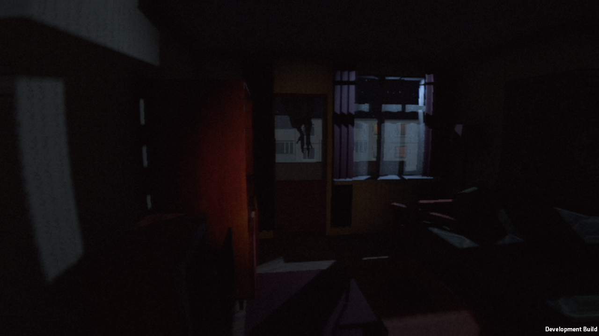
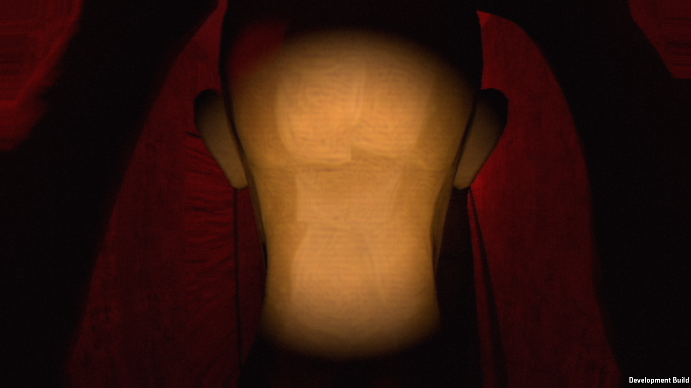

# Claude patch 12 — Windows evidence

Runtime source: 94241361c6c1b400216031257468bfc422f9b913; original Claude commit b55a76e6033046bba89a58e5bfd62a65dd7030a6. Verified patch SHA256: 055eef0f738bf4d4b85c9a769ea5056f9976cec6e5419412ab0a68436ad99069.

- EditMode: 85/85 PASS; Windows build exit 0.
- Rendered Direct3D11 full core: 52 PASS, no WARN, errors=0, coreFinished=true. Route-view balcony trigger PASS from (5.65, .02, 3.69); fallback was not needed.
- Runtime SHA256: 10670015df85d3f7c1304e48a101503743128e2970abab14f2a7ed07fa55dcc9.
- QA audio captured silently; this is not listening acceptance.
- Automation starts play programmatically; real menu clicks/human playability not yet verified. The test proves the six-loop core, NOT the complete story.

## Visual inspection

Opened original BalconyPalm-1.1 and DeathShort-1.1. Balcony now has a distant dark upside-down figure; exact palm contact/print/crack not verified. Death still fills the screen with a beige featureless mannequin. This fails the user's requirement. Do not treat darkness or passing logic as monster replacement.

## Direct user priority, 12 October ~16:00 MSK

Finish a coherent, playable game from menu through the SCENARIO story to the ending: models, textures, dialogue, interactions, death/restart/checkpoints. Detail polishing is deferred. Include a ready monster and visible black claw contact/grab/tear death, not a waving hand. Prior approval gate limiting work to the six-loop prototype is superseded by this direct request. Preserve accepted lighting/VHS and avoid rewriting the project.

Claude has been sent this implementation task in the existing authorized chat, from base 9424136, separate branch claude/playable-complete. Return bounded complete code patches with hashes; Codex builds, runs and sends real frames. No claim of complete game until the complete route is implemented and exercised.

## Menu input attempt
Normal player PID31860 launched without scenario-smoke and with silent QA capture. Computer-use located the unique game window but screenshot capture failed twice (FrameArrived timeout / window capture timeout), including one refreshed selection and activation. No coordinates were clicked blindly. Only this test process was stopped. Normal menu input remains unverified.

Claude acknowledged the full implementation request and created claude/playable-complete at /home/claude/pc. Observed work includes FaceTearDeath.cs; no new patch received or validated yet. Windows evidence follow-up is queued in the same chat.
