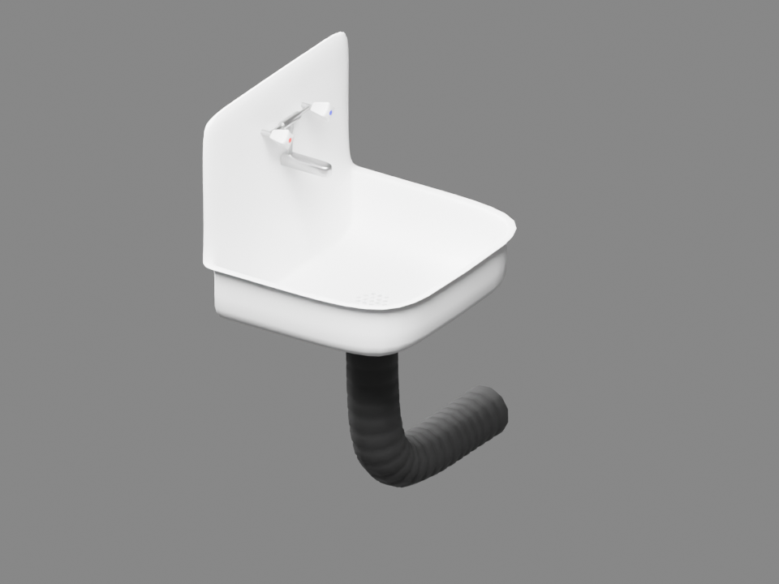
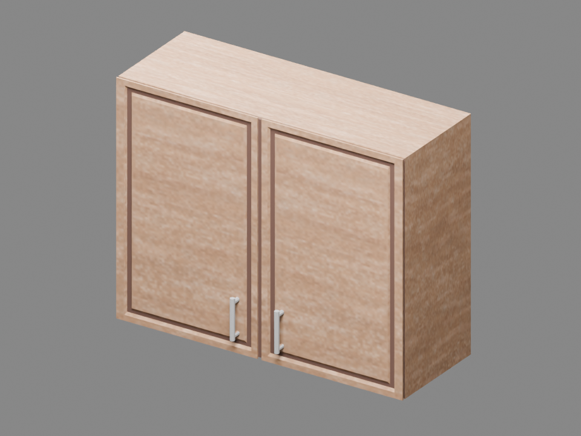
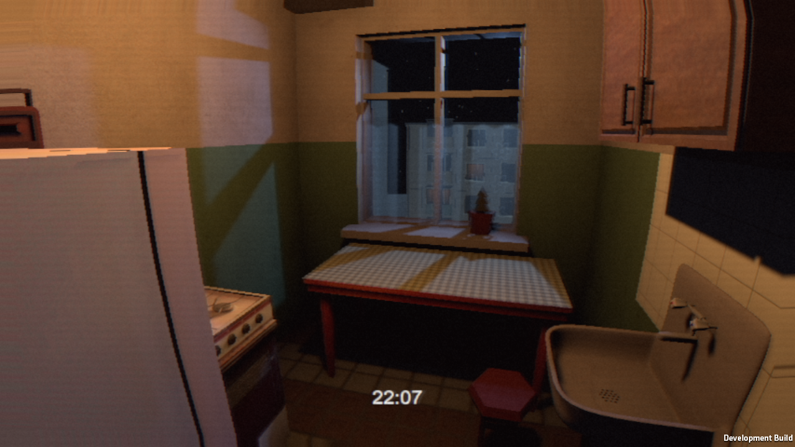

# Подготовка готовых ассетов 13

12.10.2026. Два оригинальных ассета проверены в Blender (рендеры ниже), без изменения авторской геометрии. Лицензии CC BY 4.0 и исходные SHA записаны в ImportInbox/SketchfabSources/*/SOURCE.md.

- Soviet Sink (Khata): https://sketchfab.com/3d-models/soviet-sink-789e81f99ae94875939b63c1c9da3a64. Авторская округлая раковина, кран и сифон. В исходном FBX есть UV, но нет изображений текстур. Перед помещением в игру нужны материалы. Равномерный масштаб до ширины0.65м, глубина0.438м, полная высота с сифоном0.855м.
- Wooden Wall Cabinet (skw1r): https://sketchfab.com/3d-models/wooden-wall-cabinet-pbr-game-ready-1271e258afde413e82734019eb3a0e1c. Есть авторская цветовая текстура. Равномерный масштаб0.82x0.327x0.643м. Форма и ручки сохранены.

Подготовленные FBX/текстуры в ImportInbox/PreparedKitchen13/. Это подготовка, не установка и не художественная приёмка Unity. Свет/VHS и игровая сцена не изменены. Комнаты/сюжетные runtime-файлы не менялись параллельно Claude.

## Модели монстра: зависимость остаётся открытой

Claude выбрал The Rake (Sealife Fan 3) и creepy hand (barbodoji); официальные страницы и CC BY 4.0 проверены. Скачивание GLB/оригинального FBX через Chrome открывает ERR_BLOCKED_BY_CLIENT на sketchfab-prod-media.s3.amazonaws.com. Файлов в Downloads нет. Защита не отключалась. Дима ответил, что пока не может скачать вручную. Это не блокирует код полной истории, но запрещает объявлять замену манекена готовой. Оба ассета ещё не импортированы. На странице Rake отмечены смещения глаз/рта при импорте: проверять rig/bind poses.

## Установка и проверка Windows
После предварительной подготовки модели установлены KitchenArt13.InstallAndBuild в существующую Flat.unity. Старые две Kenney-заглушки отключены. Форма не моделировалась заново. Размеры в Unity подтверждены: мойка0.438x0.855x0.65м, шкаф0.327x0.643x0.82м с поворотом к кухне. Применена имеющаяся CC0 фото-текстура к эмали раковины; шкаф сохраняет авторскую текстуру.
Build exit0; Windows Direct3D11 survey50кадров, просмотрены три оригинальных кухонных ракурса. В них форма/ориентация/масштаб читаются; источник света и VHS сериализационно идентичны до/после. Полный сюжет и проход по новой кухне НЕ проверены этим обзором. Мойка/шкаф не закрывают прежний проход по видимому кадру, но это не заменяет физическую проверку. Runtime истории Claude ещё не интегрирован.

