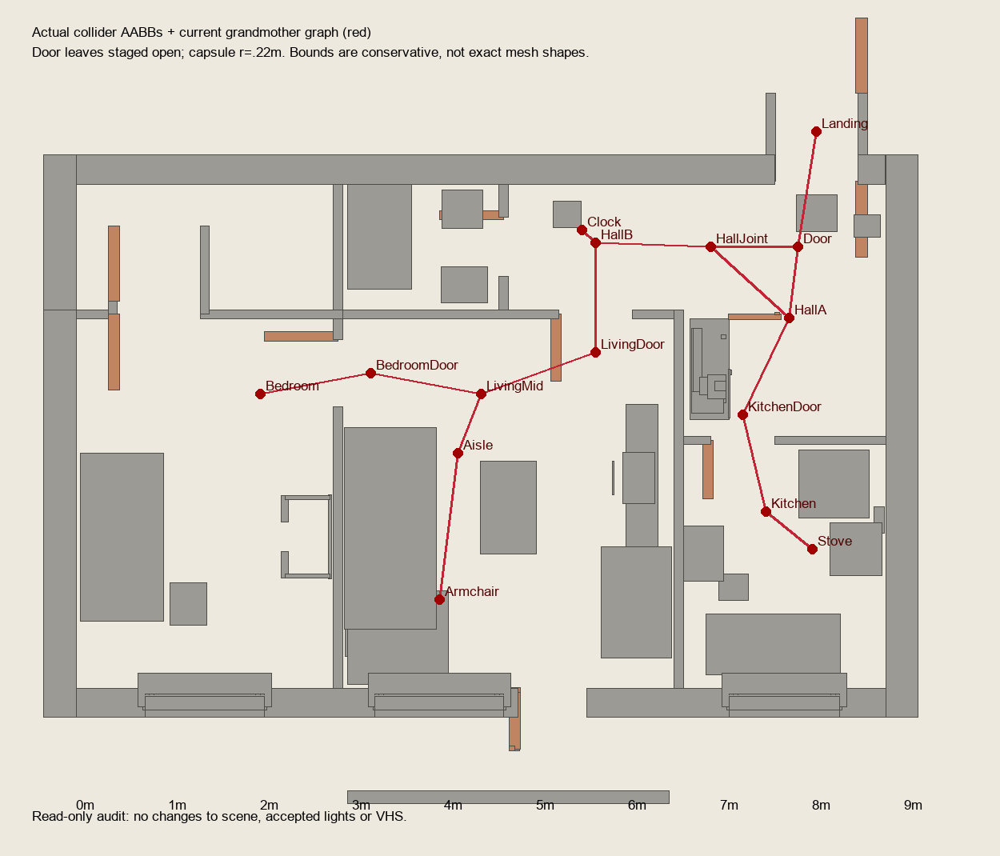

# Story15: scene coordinates for route repair

Read-only Unity export from Flat.unity, Kitchen13 current. Scene was not saved. JSON contains full collider paths and world bounds. `colliders-open.json` stages all leaves at their authored open direction, including the cupboard. Actual story door states must be checked in runtime. AABBs are conservative for rotated/mesh shapes.

Identified `wood_0` blockers: READY hallway Dresser09, cabinet body x 6.676–7.102, z 3.200–4.400. Current KitchenDoor x=7.25 leaves only .148m to it, less than r=.22. Kitchen doorway aperture x=6.90–7.60.

Fridge: x 7.855–8.625, z 2.026–2.834. Kitchen→Stove diagonal grazes its lower-left corner. Sofa x 2.921–3.919, z .704–3.096. Coffee table x4.400–5.000, z1.600–2.700; the .481m gap is tight for .44m diameter, need exact runtime sweep.

Suggested points to validate (NOT accepted or installed): KitchenDoor around (7.36,3.3), extra approach to stove around (7.55,1.57), stove standing spot (7.9,1.57). For armchair, intermediate (4.16,1.32), target (4.30,1.28) instead of cutting through sofa. Check dynamic door leaf, capsule scale, and animated body width. If gap is insufficient, Claude may adjust furniture placement, not collision validity.
