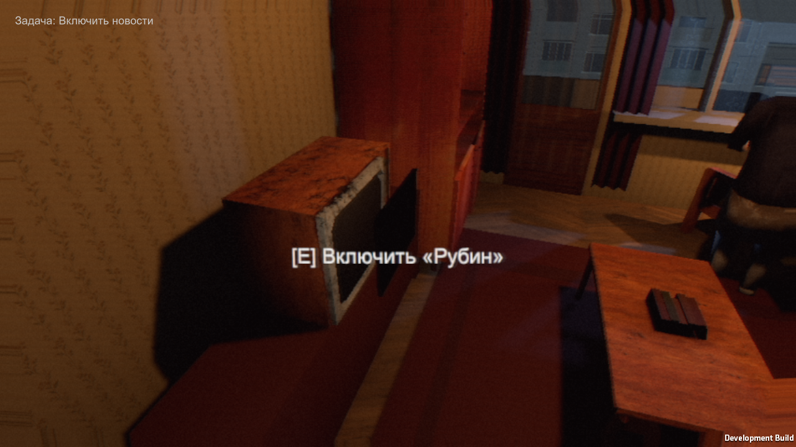
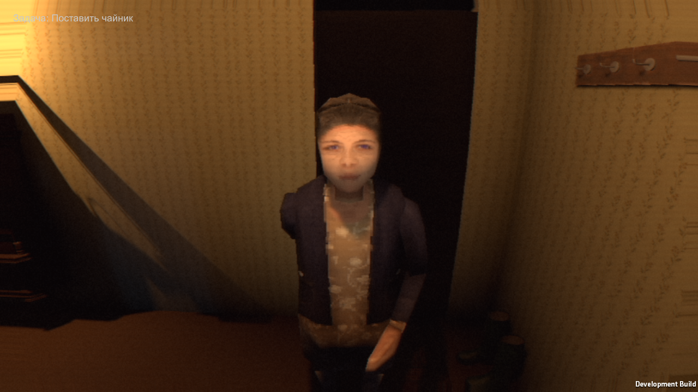

# Story15 — actual Windows integration checks, 2026-10-12

## Installed
- Claude pc09 guest-source importer, pc10 household recordings, pc11 capsule-grid grandmother routes.
- TV interaction now aims at `televisionScreen.bounds.center` instead of the hidden/edge logical pivot. Kept when merging pc10.
- ScenarioAudioBuilder installed the new bank in the existing scene; no scene regeneration or lighting migration.

## Actual results
- story15-build-b: Windows build exit 0, Unity 6000.3.26f1.
- story15-edit-b: 85/85 EditMode tests passed, including household cue presence/mono checks.
- Audio file audit: 17 prepared WAV hashes match the manifest, mono, zero clipped PCM samples. Listening pending. Radio uses the existing temporary original waltz.
- story15-flow-b (older build): failed TV aim.
- story15-flow-a (TV fix): TV action succeeded (image below). After this no next objective appeared for over eight minutes; terminated ONLY this QA process and recorded interrupted.json. No passing flow result; suspected player/grandmother obstruction still needs diagnostics.
- story15-flow-c (pc11 + bank): 0 runtime errors, FAIL, routeFailures=3. Living-room walks now have paths; Door→Kitchen, Kitchen→HallA and Door→Stove have no route. Runtime capsule matches test r=.22/h=1.5.
- Runtime logs also report GRAN_ROUTE_FAIL Door→Kitchen. She stays in the hall (image below).
- Next action fails: matches on fridge, target (8.24,1.58,2.43), eyes (8.14,1.57,3.24). Autopilot stages camera outside kitchen, so wall/door LOS must be diagnosed; do not weaken LOS to pass.

## Next corrections
1. Resolve kitchen throat: dresser and kitchen south wall/leaf; actual world bounds are in checks.txt and sibling story15-spatial.
2. Improve QA positioning/diagnostics and yield to grandmother so a staged test cannot deadlock itself.
3. Continue real Windows flow and the two death branches after fixes. Current result is NOT release-ready.

These are actual game captures, not concept images. Test stages the player and skips held durations; no full human walking/menu/audio/art acceptance is claimed.

## Update: pc12–14 and candidate Guest installed
- pc12: all nine actual Unity route checks PASS (including opened kitchen/entrance leaves). Furniture collisions preserved.
- pc13: authored OGA CC0 creature and right forearm installed in the real scene; Unity recognizes Idle/Jump/Run/Walk. Normal map imported as NormalMap; GuestVisual safely handles early enable. This is a CANDIDATE: male torso, short fingers, no grandmother face and no crawl animation. It does not satisfy the requested final Guest/long black claws. Claude explicitly received that rejection of final-art status.
- pc13 flow-e: routes 0 failures, runtime 0 errors. QA yielded the narrow TV passage and grandmother reached Landing and left. Whole result FAIL because the old one-direction Approach aimed at the lock from behind the jamb.
- pc14 flow-f: routes 0 failures, runtime 0 errors. Adaptive Approach exposed a race at the balcony: sampled the jar before the leaf opened, then the same jar became aimed during the FAILED screenshot. Result FAIL, not player-path acceptance.
- Local follow-up waits .65 game seconds before sampling QA approach; no runtime LOS, furniture or door safety logic changed. Compiled in story15-build-g. story15-flow-g is the next run; its result is not yet claimed here.
- StoryRuntimeProbe only activates with -story-smoke. It records live positions/state and actual timed DeathFull/DeathShort screenshots; never moves actors or changes story state.
- Sources/credits: [author's OGA CC0 release](https://opengameart.org/content/3d-horror-game-monster), CREDITS-GUEST.md. Author page independently checked. 17 WAV numeric audit and 85 EditMode passes above remain limited evidence, not listening/art/gameplay acceptance.

The accepted LightLab lighting/VHS and architecture were not regenerated. No new release ZIP is presented as ready. Still required: complete uninterrupted flow, negative branches, actual death-frame review, authored long claws, story props, voices and human playability/visual acceptance.
