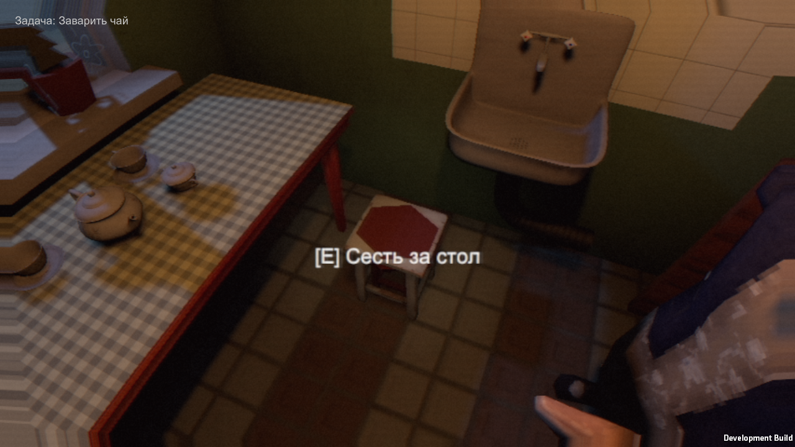
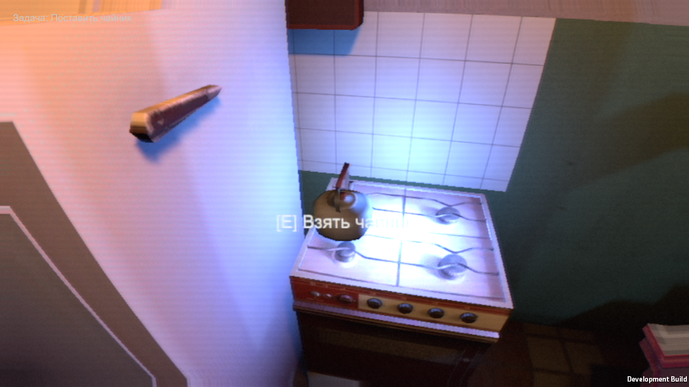

# Story16 — ready props in Windows

Actual story16-props-build-a compiled and installed Kettle, Matchbox, Bread, Belt and TeaSet. Story16-flow-a passed evening through two nights to Loop with errors=0 and routeFailures=0. The autopilot stages player positions and skips held interactions; no human walking/audio/art acceptance. Story17-edit-a: 85/85 tests passed.

Still absent: jam jar, shawl, cans; local authored bulb prepared after this build, not yet installed. Guest claws pc17 applied to source only; this build still has old death closeups, rejected in story15. Claude is fixing composition after viewing actual frames.

## Six loops, chase and finale
`story16-core-a`: passed=true, coreFinished=true, lap=6, errors=0, Direct3D11. `story16-finale-a`: ChaseEnd → Finale → DeathFull → epilogue/menu, passed=true, errors=0, routeFailures=0. These are separate instrumented runs, not one continuous manual session. Death visual remains rejected; tested transition success does not fix it.
