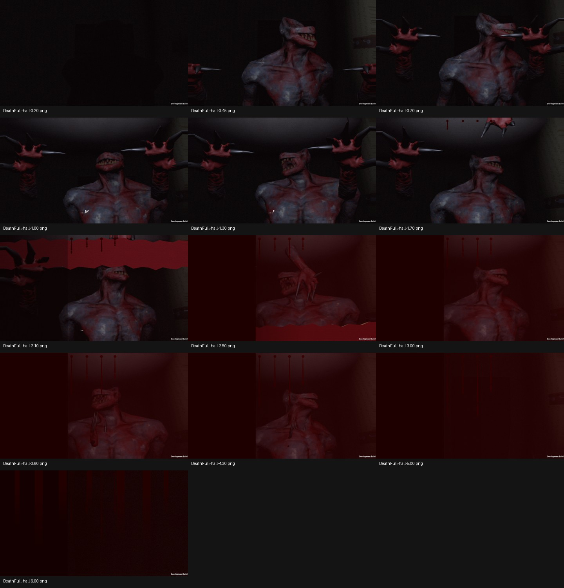
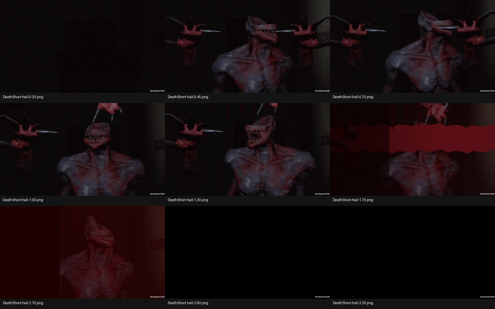

# Story18 — actual Windows death frames

Build story18-build-a installs pc17 claws, pc18 orientation/poses, and existing CC0 story bulb. Torch-on test captured all 44 frames (full/short in hall/living), errors=0.

Technical improvement: no white flashlight disk, hands/claws visible, objective HUD hidden. Still NOT accepted art: Guest body looks sideways instead of facing the player, the separate forearm ends look detached. The body is the previously disclosed male creature candidate, not a finished grandmother-faced Guest. Needs Claude review of actual frames and final user judgement.

Torch-off test also captured 44/44 expected frames with zero runtime errors. Selected actual torch-off frames and full capture log included.
