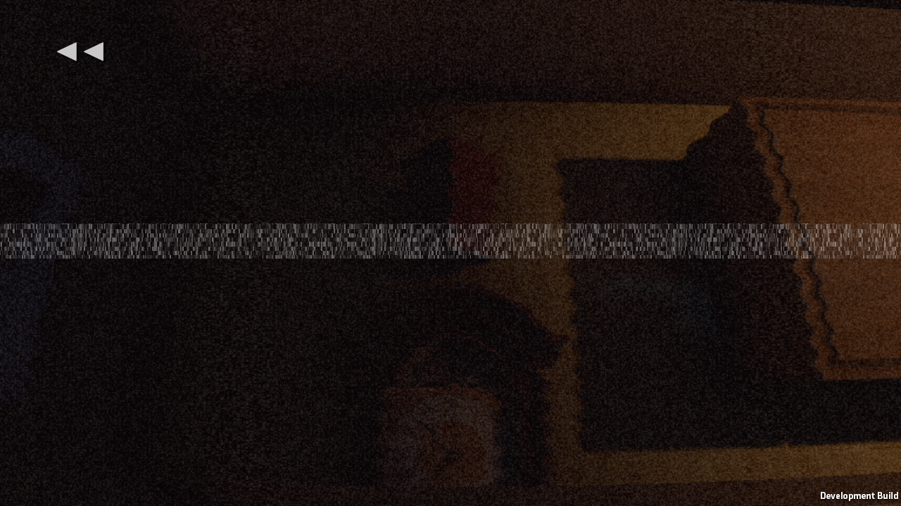
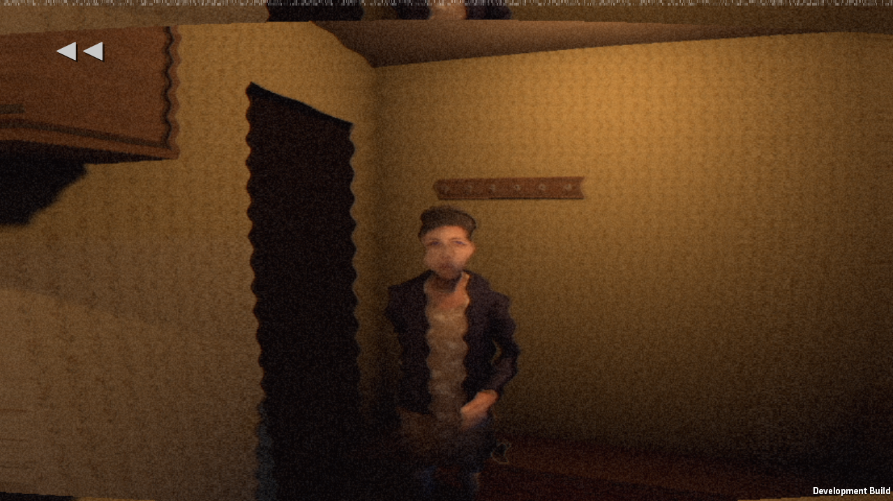

# Actual evening caught a separate snapshot-order bug

Build-g, real StoryAutopilot from Prologue. The new saved rig poses fixed the actual knock shot too: face visible, luma 0.20, facing 1.00. No runtime or navigation failures.

The run correctly FAILED on the bulb memory (luma 0.10), unlike the staged RewindQA. Inspection of the real evening code showed Remember(bulb) happened BEFORE the repaired sconce intensity was restored. That froze the broken light in a memory of the newly installed working bulb. The correction moves the snapshot AFTER the existing intensity assignment, preserving the existing room lighting value. Thresholds are unchanged. This was not a failure of checkpoint pose serialization.

The test stopped on that failure before night 2; do not report this run as a complete two-night pass.
