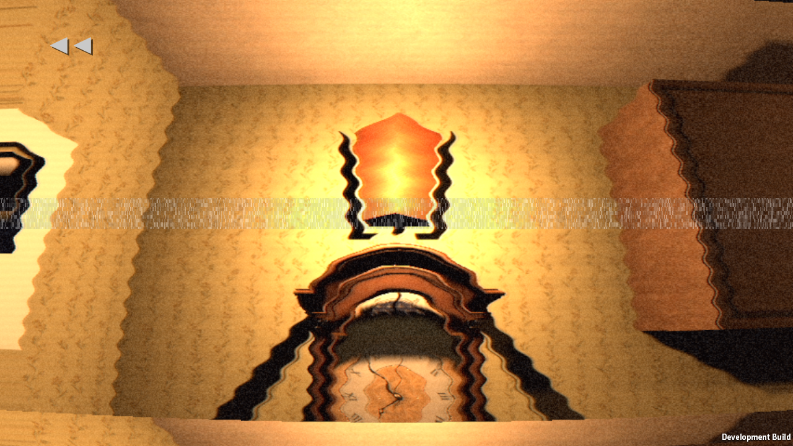
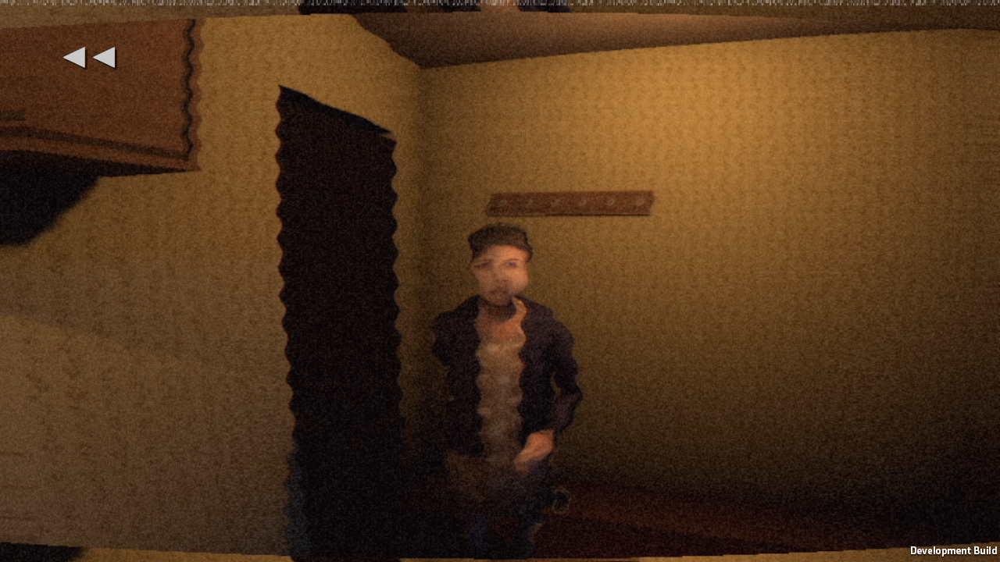

# Real evening → both nights → loop: build-h

Windows rendered StoryAutopilot, start Prologue, exit 0. Runtime errors 0, routeFailures 0. Four memories are captured at the actual evening actions, not staged by RewindQA. All four and PLAY pass visibility/darkness checks. The repaired bulb snapshot now records the existing restored sconce intensity; the bulb frame was visually inspected and shows the lit sconce. Knock pose is restored from the actual evening.

The full test continues through night 2 into loop 1. Controls/holds are invoked by the existing autopilot and waits accelerated; this is not a manual complete playthrough. The rewind itself plays at 1x. Silent listener capture confirms muted speaker output and zero dropped samples; no listening acceptance is claimed.

Source: c325dd8 + the bulb snapshot order correction later committed as 56c5623. build-h was made BEFORE pc25; this report does not validate pc25. Story23 remains untouched.

