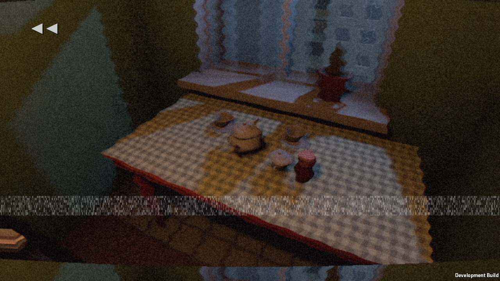
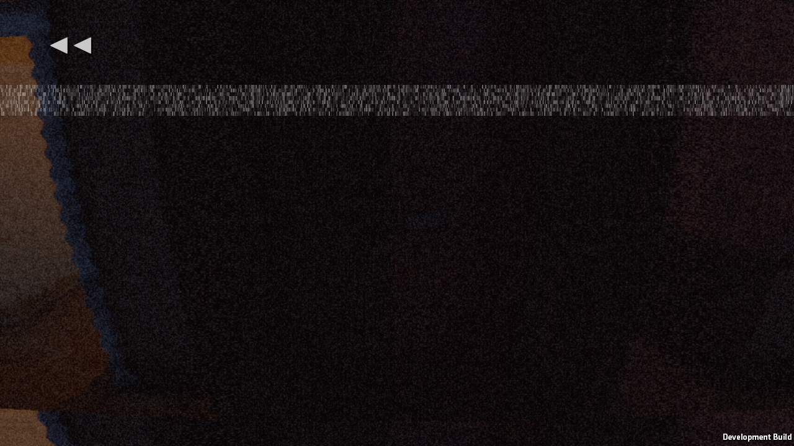
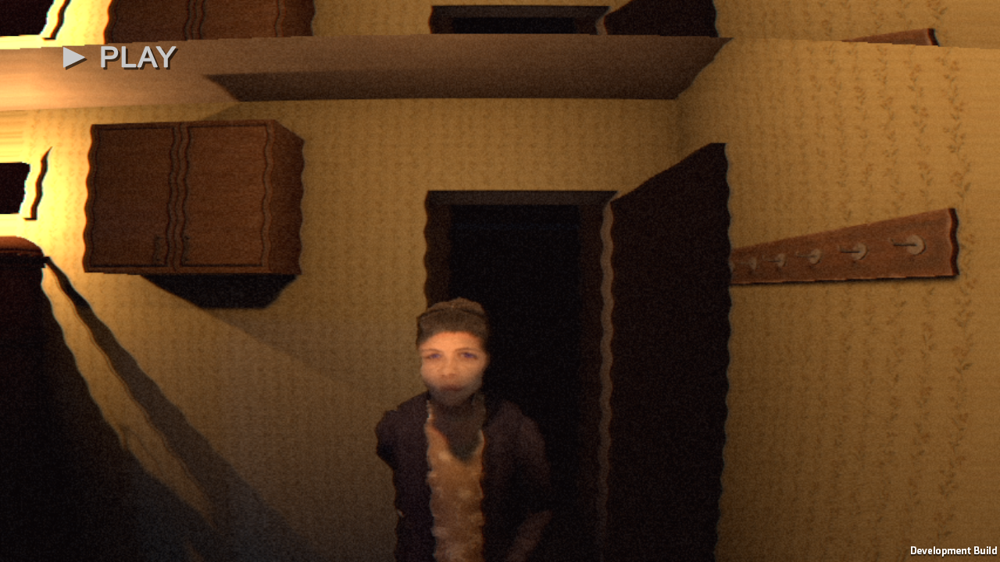

# Story24 — actual evening memories, Windows flow-c

Build story24-build-c (pc24b). Actual Prologue → Evening → Night1 → rewind → Night2 → Loop automated flow finished, exit0/errors0/routes0. Four memories came from actual evening actions, not QaRememberEvening. QA aims and fires real reachable interactions, skips holds and speeds up ordinary time; the rewind itself runs at1x. This is not manual player acceptance.

checks.txt records all actions, chapters and four memory subjects. Belt frame remains unreadably dark despite viewport/LOS checks; already sent to Claude. Source currently continues with pc24c; this evidence is pc24b only. Delivered Story23 unchanged.

