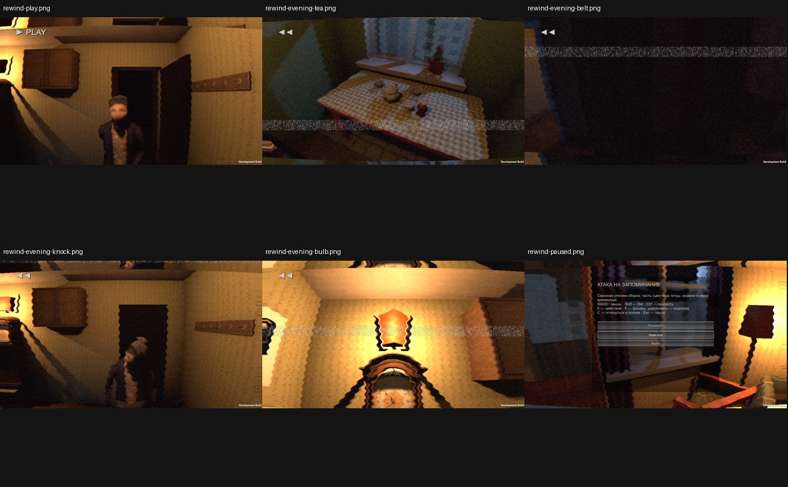

# pc24b — Windows rewind-c

Build story24-build-c, source 841b65e, patch SHA256 25d05e039c85ab7577a1cb937833491882b27d6006d418b4953a741c2f0180c1.
All internal assertions pass, runtime errors0. 9.606 seconds; 4/4 memories survive save/Continue; no light enable changes. Cache5.98MB within16MiB and cleared. 20 prepared clips, none omitted by cache limit. **Art not fully accepted.**

Actual PNG inspection: PLAY no longer clips through grandmother; tea/jam table visible; pause menu visible. Belt memory is still nearly black despite Visible=true — a raycast and viewport point alone do not prove recognizability. Knock memory shows her turned face; actual evening run still required. Pause-audio repeated starts and crouched camera fix are being handled in next Claude patch.

This run stages the four evening memories; do not claim it verifies the actual evening-to-rewind sequence. Story23 delivery unchanged.
