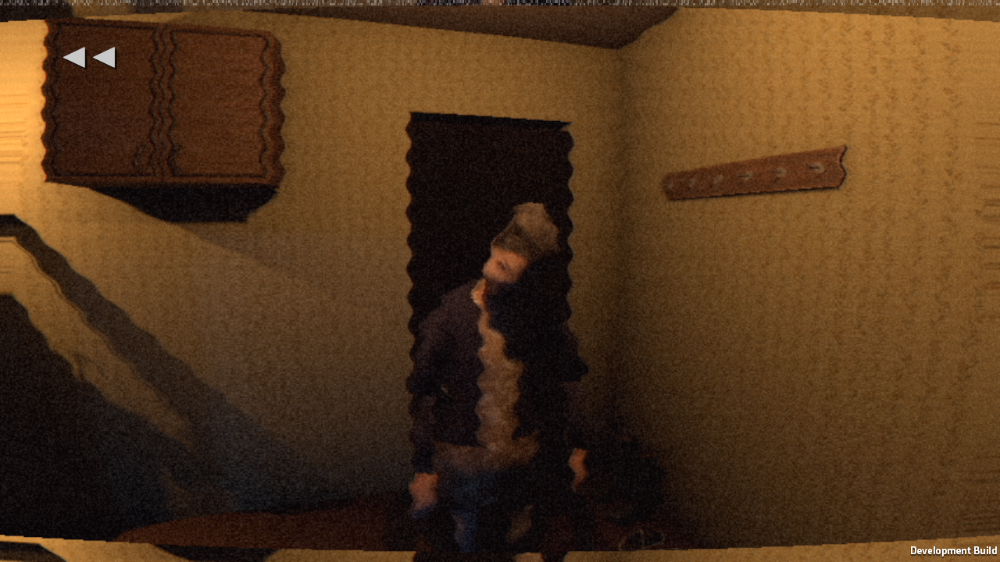
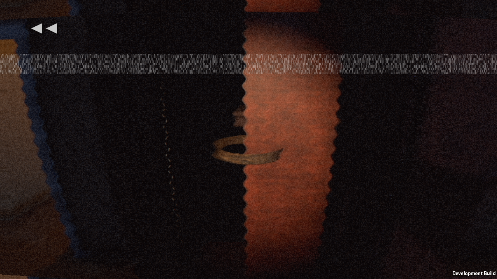

# pc24d / Windows build-e — one failure retained

Source: 9a00156, patch SHA256 441745a46a8bc6d309f290d5312f29ca9d095f8afd6732b5bc5269f6ad936376.

The real rendered run exited 1: **1 failed check, 0 runtime errors**. Belt fill 2.5 now lights the hanging strap inside the wardrobe (mean luma 0.199). The knock memory still fails the darkness floor (0.12) and visually shows a sideways hanging head. Its numerical facing cosine 0.858 was not sufficient evidence of a correct remembered pose.

Code investigation: Memory stored only the grandmother root transform, not her bone pose. Playback freezes the animation after night 1, carrying the hanging pose into the evening memory. The follow-up stores local rig transforms in the checkpoint and applies the remembered pose before framing. Older checkpoints get the existing idle clip as a fallback. The staged canonical memories explicitly sample idle; real evening memories preserve their actual pose.

The four attached crouched DeathFull frames were visually inspected. The ready Guest head and claws are visible in the first two shots, no wooden mannequin. The red flat face-tear overlay in the later frames remains placeholder art, not accepted final face removal.

Rewind 9.610 active seconds; pause clock/cue/tick drift 0; camera height mismatches 0; saved memories 4/4. Reversed tick 1 start/0 limited. Reversed one-shots 55 requested/46 started/9 overlap-limited. Sound captured silently: muted output confirmed, dropped samples 0. No listening/art audio acceptance.

Story23 deliverable remains untouched. Full game and final art acceptance remain open.
