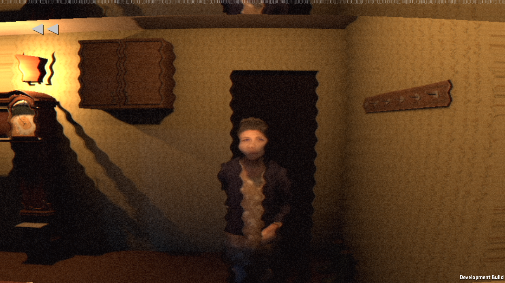
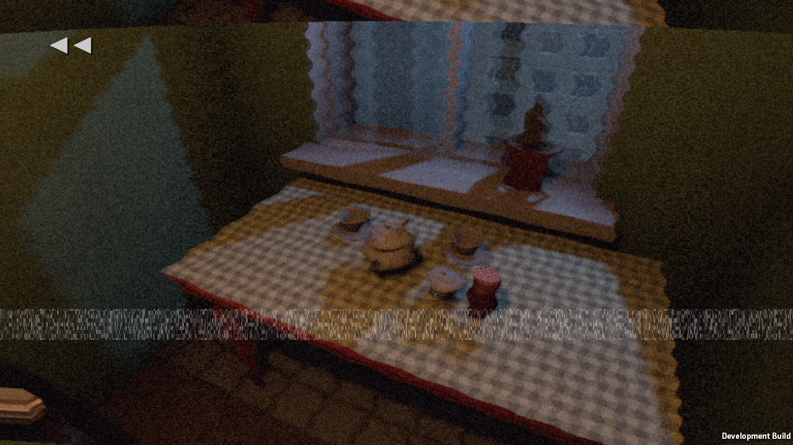
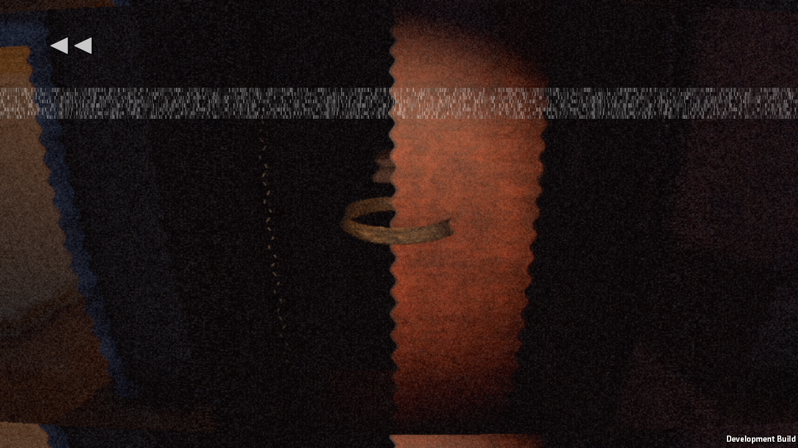

# Recorded evening rig poses — Windows build-g

pc24d plus the local recorded-pose correction. Build-f first failed compilation due to a test-local variable name collision; corrected before build-g, which compiled and built successfully.

Rendered rewind-g: exit 0, 0 failed checks, 0 runtime errors. Captures visually inspected: knock now shows an upright grandmother looking toward the player, instead of the night hanging pose. The tea setting and belt are visible. This is not an overall final art acceptance.

- Each real memory stores the 25 local transforms of the existing Katcho rig; these survive save / Continue. The two canonical QA / old-save snapshots explicitly use the existing idle clip, without replacing real evening poses.
- The remembered knock pose is restored after night 1: maximum quaternion error 0 degrees, face direction dot 0.999. Knock luma 0.17 / spread 0.30; belt luma 0.19 / spread 0.30. Lighting thresholds unchanged. Warm knock fill 0.65 and belt fill 2.5 are active only for their memory shot; general room lighting is preserved.
- 9.612 active seconds, pause clock drift 0, 0 new sound requests on pause, 0 camera height mismatches. 4 memories survive Continue, including their bone poses. 4 crouched death images captured; ready Guest head visible in both early shots.
- Tick 1 start, 0 limited. Reverse audio 56 requested / 46 started / 10 overlap-limited, reported honestly. Audio captured silently; it has not received listening acceptance.
- Normal completion and cancellation restore the prior rig pose and light/door ownership. Recording/reverse cache limits remain in place.

Next check: real StoryAutopilot from Prologue through the actual evening, both nights and into the loop. Staged rewind QA alone is not proof of the full player's journey. Story23 delivery is untouched.
