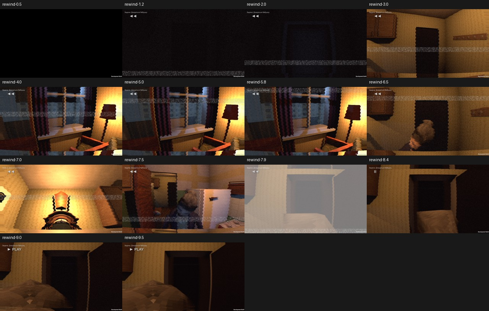

# Story24 — rejected first rendered rewind test

Real Windows run of build story24-build-b, pc24 aa33c01f integrated at 543fbb7. Not a player-ready release.

- 9.610 s active, 10.170 s including 0.516 s pause; pause drift 0.
- 2598 recorded states, 52 cues, four **staged QA evening memories**; zero reverse-order violations, zero runtime errors.
- One FAIL: one light enable state changed. Baseline was sampled during DeathFull, before flashlight is re-enabled at its end (ScenarioTimeline.cs). Need identify light by name and take rewind-only baseline at rewind start; do not silently exempt all lights.
- Visual rejection: 9.5 s PLAY frame is obstructed by grandmother hair/head very close to camera. 6.5 s knock memory also crops her. Tea memory 7.5 points at her back/fridge instead of tea/jam. 1.2 s night is almost black. Numeric checks are insufficient.
- Old task text remains throughout rewind; pause overlay and save/reload missing memories confirmed in code review.
- BytesReserved excludes reversed audio/cache and journal; currently only recording buffer estimate.

Next: pc24b fixes, real uninterrupted evening-to-night flow captures with non-staged memories, and pause screenshots. Preserve delivered Story23.
